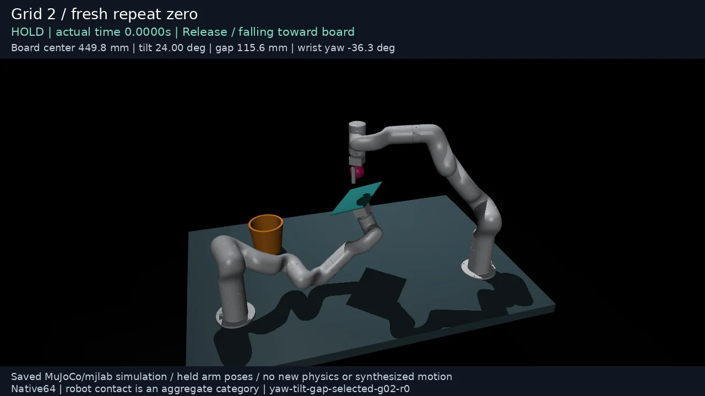
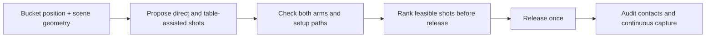

# Two arms. One bounce. A moving target.

**Sircus — Simple Circus** asks a small coordination question: can one robot release a ball while another holds a board at the right angle to bounce it into a bucket after the bucket moves?

The difficulty is shared geometry. A plausible ball trajectory is useless if either arm cannot reach its pose, the setup collides, or the rebound strikes the robot.

[](https://vimeo.com/kadiru/demo-dualarm-coordinating)

*Archived MuJoCo/mjlab simulation; both arms hold their selected poses during the drop. [Frame provenance](https://github.com/kadiru/sircus/blob/fd950dc49fc5634f70e021f40619d4e8a8f21356/baselines/mjlab-yaw-tilt-gap-20261109/video.json) · [Physical prototype film](https://vimeo.com/kadiru/demo-dualarm-coordinating). The film does not validate the simulation capture rates.*

## What has been demonstrated

The **November 16 simulation showcase captured 44/50 first drops** on its frozen target set; a separate interactive test captured 8/10. Each requested target gets at most one release, and rejected setups count against the rate. Capture means a board bounce followed by one continuous second of whole-ball containment. [Protocol, failures and source revision](docs/ONE_DROP_PLANNER.md)

These targets share one simulated table. Contact parameters and hardware calibration remain incomplete. Later experiment PRs are ongoing; the result above is a pinned, reviewable checkpoint.

## The central idea



The showcase uses nearby successful shots and fitted adjustments to propose settings, then checks reachability and clearance. Project work connects the operator workflow, scene modeling, planning, simulation and scoring. Hardware/software collaborators and third-party models retain their existing attribution.

<a name="start-here"></a>

<a name="where-the-code-lives-on-main"></a>

## Choose the right entry point

| Intent | Start here |
| --- | --- |
| Understand the November planner | [Illustrated one-drop guide](docs/ONE_DROP_PLANNER.md), with pinned experiment code and replay links |
| Inspect the portable default branch | [Two-arm geometry and kinematics](sircus/two-arm/) · [Capture scoring](sircus/two-arm/capture_scoring.py) |
| Inspect a trained model and its held-out cases | [October synthetic checkpoint and scorecard](baselines/scene-conditioned-20261030/README.md) |
| Understand the physical integration | [Operator panel and mock adapter](sircus/physical_trials/README.md) · [Stationary RGB-D capture](sircus/perception/CAPTURE_README.md) |

The **default branch** contains the earlier CPU/Viam simulator. The **November showcase** lives at the experiment revisions linked in its guide. They are different runnable snapshots.

## Run the CPU experiment on main

With Python 3.12 on Ubuntu, from the repository root:

```sh
./setup-ubuntu.sh
sircus/simulation/.venv/bin/python sircus/two-arm/train_orientation_height.py \
  --budget 4 --tests 2 --seed 42 --output experiments/first-shot
```

Use a fresh output directory and inspect its `summary.json`. This is a small fixed-scene numerical search with endpoint IK, not the 44/50 native benchmark. It requires no robot, GPU or Viam server. [Setup details](docs/UBUNTU_SETUP.md)

<a name="development"></a>

## Next milestone

Improve first-drop reliability on prespecified new targets, with setup rejects and robot contacts included. Separately resolve physical geometry and contact calibration before testing transfer.

[Repository guide and development checks](docs/REPOSITORY_GUIDE.md) · [Scoring contract](docs/SCORING_CONTRACT.md) · [Contribution workflow](CONTRIBUTING.md)

Third-party license and provenance files remain beside their assets. No additional license is granted for project-authored code.
