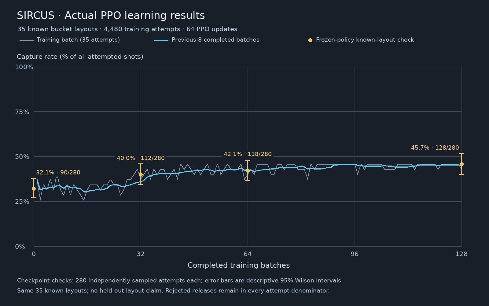

# Actual native PPO training film — November 4, 2026

A fresh categorical-PPO actor trained on native Isaac Sim 5.1 / Isaac Lab 2.3.2
rewards from 35 distinct, fixed bucket layouts and 70 articulated arms. It
started uniformly over each table's 24 native-qualified local shot geometries.
**4,480 training attempts fed 64 updates**; no assessment shots entered PPO.
The original geometry, physics, scoring, provisional bucket-height status and
selected silver-gray camera are unchanged.

## Measured learning result

Each frozen-policy check samples 280 fresh shots using the same eight independent
sampling seeds on the same 35 known layouts. No search or optimizer runs during
assessment. These are one-seed known-layout results, not a held-out spatial test.

| Training shots | PPO updates | Captures /280 | Capture rate | Clean captures | Single-board-bounce captures |
|---:|---:|---:|---:|---:|---:|
| 0 | 0 | 90 | 32.1% | 45 | 81 |
| 1,120 | 16 | 112 | 40.0% | 20 | 103 |
| 2,240 | 32 | 118 | 42.1% | 18 | 111 |
| 4,480 | 64 | 128 | 45.7% | 18 | 120 |

The observed gain is **13.6 percentage points**. Clean captures declined from
45 to 18; the unchanged reward emphasizes total capture, so this is not an
improvement in every quality measure. Clean and single-bounce subsets overlap.
Training itself scored 1,844/4,480 captures. All 5,600 training/assessment attempts
passed admission; each outcome was independently reconstructed from native telemetry.

Coverage remains limited. The final sampled check had 16 sites at 8/8 and
19 sites at 0/8; initial sampling found at least one capture at 17 sites.
Three sites (`r2c3`, `r2c5`, `r5c4`) scored during training but not in their eight
final attempts. Zero in eight is not a proof of infeasibility. Total capture
improved by concentrating probability on successful local choices; it does not
establish a solution for every table or arbitrary bucket position.

## Actual training video

`rl-training.mp4` is **60.73 seconds, 1920 × 1080, H.264/30 fps**, with 1,822 unique
native camera frames. It retains all 24 prescheduled training chapters: batches
0–7, 60–67 and 120–127. Every filmed shot is bound to the sampling checkpoint
and optimizer-input record. Setup/drop/bounce/outcome remain; quiet tails are
trimmed. Ball flight is 1×, setup timing is compressed, and there is no tracking,
looping, frozen padding, generated replacement imagery or success-based selection.
The only overlays are declared, data-derived learning/status graphics.

The chosen foreground table captured in all 24 filmed attempts. It was already
an easy site; the whole-farm curves and frozen assessments provide the learning
evidence. Both arms change measured configurations across the sequence, but not
every arm changes in every trial. Actual selection covered 15–24 options per
site, including 18 at the foreground. Its executed height/gap/tilt targets were
370–400 mm /255–285 mm /25–27 degrees. These are narrow qualified regions.

The policy learns high-level shot selection. Joint travel is scripted, balls
are initialized at release, and every scored episode receives the same canonical
endpoint initialization before unchanged measured settling/release guards.
Filmed native drives precede that common episode initialization. Grasping,
continuous joint-path control, perception and unknown-layout generalization are
not established by this recording.

## Checkpoints and verification

- [Study contract](study.json), [learning-curve data](learning-curve.json),
  [per-table counts](cell-summary.json), [verification](verification.json),
  [manifest](manifest.json).
- [Independent checkpoint audit](checkpoint-audit.json): all 160 trial files,
  133 checkpoints, 64 update links, actor changes, exact categories/actions/rewards,
  4,480 training and 1,120 assessment likelihoods. Maximum CPU/CUDA log-probability
  error 1.43e-6. Optimizer arithmetic is not independently reconstructed.
- Initial and three later frozen assessment checkpoints: `assessment-policy-000.pt`,
  `assessment-policy-032.pt`, `assessment-policy-064.pt`, `assessment-policy-128.pt`.
  Final model: `policy-final.pt`. Preserve the version, study/geometry/menu hashes,
  architecture and update counters; load with the task's `load_checkpoint`, which
  uses `weights_only=True` on CPU. These policies are incompatible with the old
  Gaussian or Viam-runtime policy adapters.
- Native exporter independently checked all 5,600 scored outcomes against
  5,376,000 all-cell 240 Hz observations, plus exact camera, measured ball/joint/board
  packets, original/fresh probes, source identities and complete movie decode.
  Mac media hashes match Ubuntu. Six encoded early/middle/late/final samples and
  the standalone curve were visually reviewed.

293 local tests completed successfully with 28 dependency skips. All 50 new tests
passed in Ubuntu's actual CPU Torch/Pillow environment. The bounded native process
exited 0 after 1,726.05 seconds including assessments and filming; this is not a
headless-training-only timing benchmark. The 4090 was idle afterward, the existing
4070 workload and services were untouched, and about 78 GiB remained. No physical,
Viam or audio action occurred. Previous studies and the completed benchmark stay frozen.

## Reproduction and artifact locations

[Protocol and commands](../../sircus/isaac/NATIVE_RL_FILM.md).
Producer: `207811f28364a2c09fedb221e8553fde0f7562b2`;
exporter: `22dabe7021ce6715b27e3aedce2944d7e0f7b5c7`.
Native run: `~/sircus-isaac/output/native-rl-film-20261104-v1`;
export appends `-export`. Mac copies are under
`.runtime/media/native-rl-film-20261104/` in the project directory.
Raw RGB/NPZ/trial observations, intermediate checkpoints, logs, archives and the
movie remain outside Git. The preexisting native-qualified menu/geometry assets
are referenced from `baselines/isaac-expanded-farm-20261102/`; their original
fingerprints and reported-height uncertainty remain intact.
