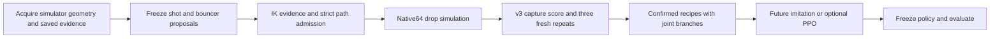

# Fixed-grid bouncer alternatives — completed and audited

This completed follow-up uses frozen producer
`ac872e8e39fa181b2e716ce04633bdd57e6a9018` in
[draft PR #123](https://github.com/kadiru/sircus/pull/123).
The separate V3 audit passed 35,407 checks. [Completed baseline](../baselines/mjlab-fixed35-bouncer-20261110/README.md).

The completed first pass added one recipe with 3/3 fresh captures and replayed
all 29 prior recipes successfully: **30/35 fixed locations have confirmed
recipes**. The existing frozen policy still scores **24/35**. These are different
measurements: a collection of searched recipes versus a policy's predictions.

## Why this follow-up exists

At the three remaining searchable cells, the first pass's selected second
branches changed the dropper wrist but retained the same bouncer joints. Saved
endpoint evidence contained bouncer alternatives that had not been flown.
This follow-up tests those saved alternatives without another IK optimization.

| Grid | Bucket X/Y (mm) | Frozen bouncer alternatives |
|---|---|---:|
| 03-04 | (860, 25) | 3 |
| 03-05 | (1050, 25) | 5 |
| 04-06 | (1240, 250) | 7 |

The **15 alternatives** keep the exact numeric shot, bucket and dropper joints.
Selection prefers a distinct shoulder/elbow, then a distinct wrist when available.
Every saved bouncer vector must pass unchanged endpoint and setup-path checks.

The two other unresolved cells, 03-00 and 03-06, remain excluded because the
compiled bucket/base shapes overlap by approximately **71.0 and 73.6 mm**.
No such impossibility claim applies to the three searched cells.

## Protocol and workflow

Acquisition uses simulator geometry, not camera or point-cloud perception.
Here, IK evidence is reused; no new IK solve occurs. Capture requires board
bounce, whole-ball entry and one continuous second inside. Table/rim assistance
counts. Robot, floor or unattributed contacts and invalid physics cannot count
as valid captures.

All **30 known recipes** are replayed unchanged, with **18 original controls**
before and after the search. Each discovery receives three fresh repeats of
its exact admitted joint branch; at most three confirmation groups per cell.
The maximum is **99 requests**, with a 3,600-second worker cap and search stopping
at 2,400 seconds. All flights use 64 substeps; noise/timestep variation is untested.

## Learning boundary

The existing policy receives **nine normalized features**: target bucket X/Y,
reference bucket X/Y, and the reference board X/Y/Z, tilt and drop gap. It
outputs **five residual shot parameters** around that reference: board X/Y/Z,
tilt and gap, bounded by ±40/40/50 mm, ±8°, and ±120 mm respectively.
It does **not** select a joint branch.

A future refit must preserve or select the verified bouncer branch as well as
its five shot parameters; copying only the parameters could restore the old
obstruction. Branch-aware policy execution is not implemented by this search.
Imitation fitting, optional PPO and frozen-policy validation are future tasks.
Frozen evaluation must measure model predictions without per-position search.

## Audited results

| Measurement | Recorded outcome |
|---|---:|
| Requests / native releases / setup refusals | 63 / 63 / 0 |
| Alternative bouncer poses / captures | 15 / 0 |
| Fresh preserved recipe captures | 30/30 |
| Original controls | 18 requests; both pre/post gates passed |
| Invalid-physics shots | 0 |
| Worker elapsed time | 572.2384 seconds |

No candidate entered whole-ball or earned a confirmation group. Recorded robot
contact preceded any bucket contact in **13/15** candidates; in **2/15**, bucket
contact came first. Those later robot contacts do not explain the initial bucket
miss. The 15 matched parent comparisons had 11 early, three late and one absent
robot contact. Contact forces identify the robot category, not individual links.

There is no added recipe: coverage remains **30/35**, while the unchanged
frozen policy remains **24/35**. No geometry correction or policy improvement is
claimed. Report SHA-256:
`499a0353b1e3a0b439582e613ed41da666d11eea25c99f48060c42e98c771c0d`.
The separate V3 audit passed 35,407 checks in 11.1481 seconds. The original
583.8384-second pipeline retains its audit-failure status and receipts: missing
historical branch metadata, followed by near-zero angular rounding. V3 checks
authenticated metadata and exact saved-target certificates without altering
the native evidence, scoring or clearance gates. Full details and hashes are
in the completed baseline. All 117 protected files and services stayed unchanged;
the owned 4090 worker exited. No further run is queued.

No UI, policy, service or physical changes. Raw evidence stays outside Git.
See [protocol](../sircus/mjlab/FIXED35_BOUNCER.md) and [first pass](MJLAB_FIXED35_SIX_20261110.md).
