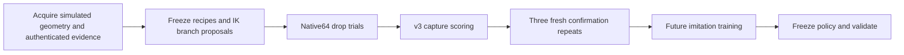

# Six remaining fixed-grid cases — first pass completed

The experiment was launched from frozen producer
`e6a11db6b0c00c278874d04800b1b38e78080040` on the 4090.
[Draft PR #123](https://github.com/kadiru/sircus/pull/123).
The independent audit passed **170,755 checks**. A separate targeted bouncer-branch
follow-up addresses the selection limitation found during final review.

The historical frozen policy remains **24/35**. The preceding recovery study
established **29/35 locations with confirmed recipes**; that recipe collection
is not a newly trained policy. This task replays those 29 exact recipes and
searches the remaining feasible candidates without changing bucket positions.

## Workflow and boundary

This task stops at confirmed recipes and an independent evidence audit.
Acquisition uses simulator geometry, not camera perception. A capture requires
board contact, whole-ball entry and one continuous second inside; table/rim
assistance counts. Robot, floor and unattributed contacts invalidate capture.
Invalid physics remains separately identified. Repeats retain the same action
and admitted joint branch; they do not test placement noise or 128 substeps.

Future imitation would learn shot parameters from confirmed examples. A later
frozen-policy validation must report its own predictions and capture count,
without substituting a per-position search. Neither training nor promotion is
part of this experiment.

The existing policy takes nine normalized geometry/reference-recipe values and
predicts five residual shot parameters: board X/Y/Z, tilt and release gap. It
does not output an IK branch. Any future refit using an alternate-branch recipe
must also preserve or select its verified joint configuration; copying only
the five parameters could reintroduce a different elbow obstruction. That
branch-selection integration is not implemented by this search.

## Six cases and frozen limits

| Grid row-column | Bucket X/Y (mm) | Treatment |
|---|---|---|
| 01-05 | (1050, −425) | Bounded recipe and alternate-IK-branch search |
| 03-04 | (860, 25) | Bounded recipe and alternate-IK-branch search |
| 03-05 | (1050, 25) | Bounded recipe and alternate-IK-branch search |
| 04-06 | (1240, 250) | Bounded recipe and alternate-IK-branch search |
| 03-00 | (100, 25) | CPU geometry audit only; no drop request |
| 03-06 | (1240, 25) | CPU geometry audit only; no drop request |

The preflight audit found actual compiled collision-shape overlap at the two
blocked cells: approximately **71.0 mm** at 03-00 and **73.6 mm** at 03-06,
supported by signed-distance queries and interior witnesses. The robot bases,
buckets and collision rules stay unchanged. These two layout conflicts cannot
be repaired by choosing a different arm posture while keeping those fixed
objects in place. No such impossibility claim applies to the other four cells:
a finite unsuccessful search would only show that its tested candidates failed.

Each searchable cell has 96 distinct numeric proposals, each offered with IK
branch slots 0 and 1. Parameters include board X/Y, radius around the unchanged
bucket, height, tilt and drop gap. Invalid bounds are discarded before freezing;
values are not silently clipped. Missing alternate branches decline explicitly.
Bucket-facing dropper orientation stays fixed.

| Phase | Maximum requests | Audited actual/result |
|---|---:|---|
| Four-cell search | 768 | 591 requests, 37 releases, one capture |
| Fresh confirmation: up to three groups per cell | 36 | 3/3 captures |
| Unchanged prior recipes | 29 | 29/29 captures |
| Before/after controls | 18 | Both gates passed |
| Total | 851 | 641 requests, 87 releases |

The search cutoff is 5,400 acquired seconds; the worker cap is 7,200 seconds.
Each cell stops after a 3/3 confirmation or three failed confirmation groups.
The audit will distinguish exhausted proposals, missing IK branches, setup
refusals, valid flight misses, invalid physics and time truncation. No all-space
coverage claim follows from this bounded study.

## Completed first-pass results

- 641 requests: 591 search, three fresh repeats, 29 unchanged recipes, 18 controls.
- All 29 previous recipes recaptured; 01-05 confirmed 3/3: recipe coverage 30/35.
- Three cells exhausted 96 numeric poses each; only four poses/eight drops per
  cell admitted, with no captures. Two cells have actual bucket/base overlap.
- Zero invalid physics; both control gates passed; 170,755 independent checks.
- Worker 1,704.930 s, pipeline 1,724.412 s. No budget truncation.
- 112 protected files unchanged; services unchanged; owned 4090 job exited and no
  GPU compute remains. No UI publication, model change or 4070/Isaac operation.

**Important search limitation:** all selected second branches at the three
remaining cells changed only the dropper wrist. Eighteen endpoint-valid bouncer
alternatives across 11 poses were left untested when the first two pair paths
filled the slots. Seven variants across four poses change shoulder/elbow. A
separate targeted follow-up must path-check and simulate them before claiming
that alternate bouncer posture was thoroughly explored.

Exact recipe, case statistics, event examples and immutable evidence hashes are
in the [completed baseline](../baselines/mjlab-fixed35-six-20261110/README.md).

Only combine new confirmed cells with prior coverage after reporting all 29
fresh preservation results. Keep the original policy's 24/35 score unchanged.
Raw trajectories, runtime configurations and logs remain local; compact audited
results belong in the [baseline folder](../baselines/mjlab-fixed35-six-20261110/README.md).
The [frozen protocol](../sircus/mjlab/FIXED35_SIX.md) describes the full limits.
No UI update, service restart, hardware command or 4070/Isaac change is requested.
