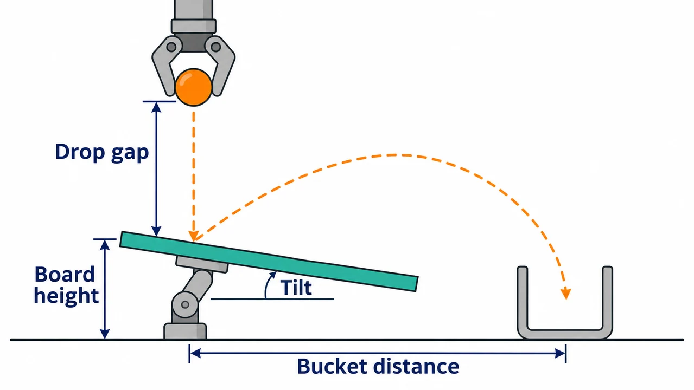

# How Sircus chooses one shot

In the November 16 simulation showcase, moving the bucket creates a new planning problem. Arm10 releases the ball and Arm14 holds the board with a suction tool. A direct shot bounces from the board into the bucket. A table-assisted shot also bounces on the tabletop before entering the bucket.

*Shot geometry from the project slides. The dashed line illustrates a direct route. The simulator records the actual flight.*

## From a bucket position to one drop

| Step | What the planner does |
| --- | --- |
| 1. Propose shots | Start from successful shots at nearby bucket positions. Separate ridge regression models adjust seven settings for a direct or table-assisted route. The settings are board X, Y, height, tilt, heading, twist and drop gap. |
| 2. Check both arms | Use the saved arm joints to initialize inverse kinematics. Check endpoint poses, setup paths and collision clearance. If every initial candidate fails setup, try a wider pool. |
| 3. Choose one | Rank feasible candidates using approximate rebound and flight clearance at the arms and bucket rim. This uses only information available before release. |
| 4. Score the drop | Hold both simulated arms at their selected endpoints and release once. A standard capture requires a board bounce and one second of continuous whole-ball containment. Rim and table contacts are allowed. Robot or floor contact disqualifies the shot. |

The regression models use numeric scene, joint and shot data. Each prediction adjusts a saved setting for a new bucket position. The separate Isaac Lab experiments train a neural policy to choose high-level settings. [Shot model](https://github.com/kadiru/sircus/blob/9b59b84b8820b40790ebe20f1a036c1ea8679282/docs/MJLAB_CONTINUOUS_SHOT_MODEL.md) · [Route-specific models](https://github.com/kadiru/sircus/blob/9b59b84b8820b40790ebe20f1a036c1ea8679282/sircus/mjlab/intergrid_route_models.py) · [Isaac Lab study](https://github.com/kadiru/sircus/blob/473c98f80146b89d31cae6556dab7c672155b0a6/baselines/isaac-seed22-continuation-20261110/README.md).

## What happened on new targets?

| November 16 simulated evaluation | First-drop captures / all requested positions | Observation |
| --- | --- | --- |
| Frozen planner benchmark | **44 / 50 (88%)** | All 50 targets passed setup. There were 31 direct captures and 13 table-assisted captures. |
| Separate interactive UI test | **8 / 10 (80%)** | Six direct and two table-assisted captures. On both misses, the ball struck the board arm after rebounding. |

Each requested position gets at most one release. A rejected setup counts against the capture rate. These tests used different target positions on the same simulated table. Real material and contact parameters remain uncalibrated. [Benchmark protocol](https://github.com/kadiru/sircus/blob/9b59b84b8820b40790ebe20f1a036c1ea8679282/docs/MJLAB_SYSTEM_PLANNER.md) · [Results and saved-miss replay](https://github.com/kadiru/sircus/blob/9b59b84b8820b40790ebe20f1a036c1ea8679282/sircus/mjlab/web/README.md).

## Explore the implementation

The showcase links below open the November 16 experiment revision. The default branch carries the earlier CPU/Viam simulator and its portable baseline.

- **Shot generation and selection.** Read the [regression features and predicted adjustments](https://github.com/kadiru/sircus/blob/9b59b84b8820b40790ebe20f1a036c1ea8679282/sircus/mjlab/intergrid_proposer.py), then the [one-drop planner](https://github.com/kadiru/sircus/blob/9b59b84b8820b40790ebe20f1a036c1ea8679282/sircus/mjlab/intergrid_system_plan.py).
- **Native simulation and replay.** The [viewer guide](https://github.com/kadiru/sircus/blob/9b59b84b8820b40790ebe20f1a036c1ea8679282/sircus/mjlab/web/README.md) explains how to preview the arm setup, run a single drop and inspect its saved trajectory. Reproducing the native run also requires the matching robot assets, scene, shot libraries and prior study artifacts.
- **Runnable CPU example.** The [quick start on main](../README.md#run-the-cpu-experiment-on-main) runs a smaller fixed-scene search. The [published CPU study](../baselines/scene-conditioned-20261030/README.md) includes its frozen checkpoint and eight-layout scorecard.
