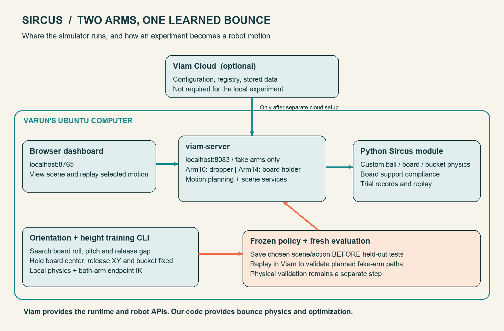

# Sircus Ubuntu two-arm simulator

This repository provides an isolated two-arm UFACTORY850 simulator and an orientation/height experiment. It contains no physical robot credentials and does not control sfhack10. Older handoff/status files are historical snapshots, not current startup instructions.

## What runs where



Viam Cloud stores configuration, registry packages and uploaded data. It does not run our simulation automatically. A machine part is the computer running viam-server. The server hosts fake arm APIs, motion planning, the scene service and our Python Sircus module. The Sircus code supplies compliant-board bounce physics and optimization. A browser is a client; opening the existing offline sircus-sim cloud page does not transfer or start its runtime.

The new training CLI runs numerical experiments locally, with no server or cloud connection. The optional local server/dashboard lets you see the two-arm scene and replay the selected action through Viam motion planning. The supplied local path uses port8083 and no cloud credentials; dashboard port8765. Keep both bound to127.0.0.1.

## 1. Clone the shared repository

```bash
git clone https://github.com/kadiru/sircus.git
cd sircus
```

You can clone this public repository without signing in. This repository is the source of truth; transfer archives are historical snapshots. Read CONTRIBUTING.md before making changes. Internet is needed for dependency installation. No GPU is required for the small search.

## 2. Set up Python (Ubuntu24.04 recommended)

```bash
sudo apt-get update
sudo apt-get install -y python3.12 python3.12-venv curl ca-certificates
./setup-ubuntu.sh
```

Other Ubuntu versions may not provide Python3.12 in their default repository. Install Python3.12 using your normal approved method, then set SIRCUS_PYTHON to its executable when running setup-ubuntu.sh. Do not copy a Mac venv to Linux. Direct dependencies are pinned in sircus/simulation/requirements-viam.txt; installation must succeed without silently changing their versions.

## 3. Start the NEW orientation + height experiment

From the repository root:

```bash
sircus/simulation/.venv/bin/python sircus/two-arm/check_orientation_height.py
sircus/simulation/.venv/bin/python sircus/two-arm/train_orientation_height.py \
  --budget 32 --tests 10 --seed 42 \
  --roll -20 20 --pitch 10 50 --gap 60 380 \
  --output experiments/orientation-height-001
```

Each candidate changes board roll and pitch (degrees) and the vertical release gap (mm). Board yaw, board center, bucket, world release X/Y and the dropper's downward orientation remain fixed. Board-local U/V are recomputed so rotating the board does not silently move release X/Y. The board arm's tool pose is computed using the landscape suction mount transform. Both arms' inverse-kinematic endpoint checks are applied before evaluating contact physics. These checks are NOT collision-planned paths.

The default release X/Y is derived from the earlier bucket baseline. Use --release-xy X Y to choose a different fixed line. All generated contact points must fit the board; infeasible candidates are recorded, not treated as successes. Gap is measured vertically above the sphere-center contact plane in this model; it is not an independently calibrated real flange-to-board distance.

The search uses bounded random proposals followed by local refinement. It optimizes the existing bounce reward, including bucket retention. The first candidate seeds the known baseline if within bounds. This is a useful low-dimensional fixed-scene optimizer, not deep RL, torque control, or a general policy for arbitrary bucket positions.

Outputs include scene.json, experiment.json, every train/test record, selected-scene.json, policy.json and summary.json. The policy is frozen BEFORE fresh held-out trials with +/-2mm release X/Y noise and +/-3mm gap noise. Tests do not tune the policy. No outputs are uploaded automatically. Use a NEW output directory per run; existing experiments are never overwritten. The selected policy has its own schema and scene/source fingerprint and is not mixed into the old fixed-board policy cache.

For a quick check use --budget 4 --tests 2. Increase budget after the full local setup works. CPU/IK runtime depends on machine and bounds. An all-infeasible run is a failed experiment, not a learned behavior.

## 4. Install and start the native Viam runtime

Use Viam's official Linux installation instructions:
https://docs.viam.com/operate/reference/viam-server/manage-viam-server/

Their installer can be downloaded and inspected before running:

```bash
curl -fsSL https://storage.googleapis.com/packages.viam.com/apps/viam-agent/install.sh -o /tmp/viam-install.sh
less /tmp/viam-install.sh
sudo /bin/sh /tmp/viam-install.sh
```

This is a system installation, not a step performed by setup-ubuntu.sh. If you already run Viam on this computer, use the existing executable; do not replace its service/configuration. The documentation lists /opt/viam/bin/viam-server on Linux. Confirm the executable exists and record its version. The tested Mac baseline is viam-server1.14.3; a different installed Linux version requires the validation steps below. Native Linux compatibility has NOT been tested here. Linux x86_64 and aarch64 use different binaries; never run the included historical Mac launcher.

No cloud machine registration is required for our local test configuration. From the package root:

```bash
./start-local.sh
```

Keep this terminal running. To use an explicitly installed executable:

```bash
SIRCUS_VIAM_SERVER=/absolute/path/to/viam-server ./start-local.sh
```

The launcher checks that8083 is free, regenerates absolute paths for this extraction location, and starts only the generated fake-arm config. It does not change any cloud part. run-local-test.sh is the server-managed module entrypoint, NOT the server launcher.

## 5. Open the two-arm dashboard

In another terminal, from the repository root:

```bash
sircus/simulation/.venv/bin/python sircus/two-arm/check_native.py --local
sircus/simulation/.venv/bin/python sircus/two-arm/local_dashboard.py --port 8765
```

Open http://127.0.0.1:8765. The badge should say LOCAL FAKE-ONLY. If8765 is occupied, choose --port 8767. Do not use the legacy server.py --offline mode: that is the older standalone scene. The local bridge in this package is what connects the current two-arm dashboard to8083.

The dashboard's existing Learn release button still performs the OLD U/V/gap search at a fixed board pose. Use the NEW CLI in step3 for board-orientation training. After training, replay its selected candidate with:

```bash
sircus/simulation/.venv/bin/python sircus/two-arm/replay_orientation_height.py \
  experiments/orientation-height-001/policy.json
```

This verifies scene/source identity, positions the simulated board and performs the fake-arm release sequence through Viam motion planning. Watch it in the dashboard. It saves native-replay.json separately. A planning failure means the candidate is not path-validated, even if its physics score is high. Do not train via the dashboard and replay concurrently. Ctrl-C each foreground terminal to stop only these local processes.

## 6. Baseline geometry and uncertainty

- Two official UFACTORY850 models; base spacing1337.31mm from measured52.65in. Existing X-axis interpretation, Y/Z and180degree base yaw remain assumptions.
- Board200x300x5mm,90degree landscape suction mount. Board mass0.4kg, tool offsets/support point and compliance are provisional.
- Bucket inner diameters177mm top/150mm bottom; outer diameters200mm top/158mm bottom. Straight taper, open top. Inner geometry is for ball contact/capture; outer proxies are for robot clearance.
- Reported height175mm is unresolved: overall height versus interior depth. Simulation assumes175mm interior depth plus unmeasured8mm base. Placement is provisional.
- Ball diameter75mm and mass0.2kg are provisional. The reduced-order model includes support deflection/tilt, but omits ball spin, board bending and full robot dynamics.

Original bucket evidence and older rectangular-container results remain separate under the historical transfer archive; a compact bucket reference is in baselines/bucket-20261029. Do not attribute old results to a changed scene. Do not upload historical archives as new trials.

## 7. Verification and next learning work

See baselines/README.md and run the tests with scripts/test.sh. New trainer, endpoint checks, fake-arm native replay and local dashboard were exercised on the Mac; Ubuntu installation was not executed. Run checks after installation:

```bash
cd sircus/two-arm
../simulation/.venv/bin/python check_bucket_physics.py
../simulation/.venv/bin/python check_physics.py
../simulation/.venv/bin/python check_bucket_native.py
../simulation/.venv/bin/python check_training_data.py
../simulation/.venv/bin/python check_guard.py
../simulation/.venv/bin/python check_orientation_height.py
```

Then rerun numerical evaluation on Ubuntu; a matching fingerprint does not establish cross-platform numerical equivalence. Current held-out tests cover small release noise only. Next: vary bucket poses and board support/rebound parameters, train across scenes, hold out entire scenes, and fit the contact model to measured physical bounces before hardware deployment. The Mac sfhack10 dashboard is a separate workstream.

## Optional cloud visibility later

Create a separate sircus-sim-varun machine identity and deliberately update binding/guard/bridge configuration if needed. Our local path needs no credentials. Do not start a second computer under the existing sircus-sim part or point this package at sfhack10. Credential types for future cloud setup are documented in docs/CREDENTIALS.md; no actual credentials are included.

Official architecture: https://docs.viam.com/set-up-a-machine/viam-agent-and-server/
Fake arms: https://docs.viam.com/components/arm/fake/
