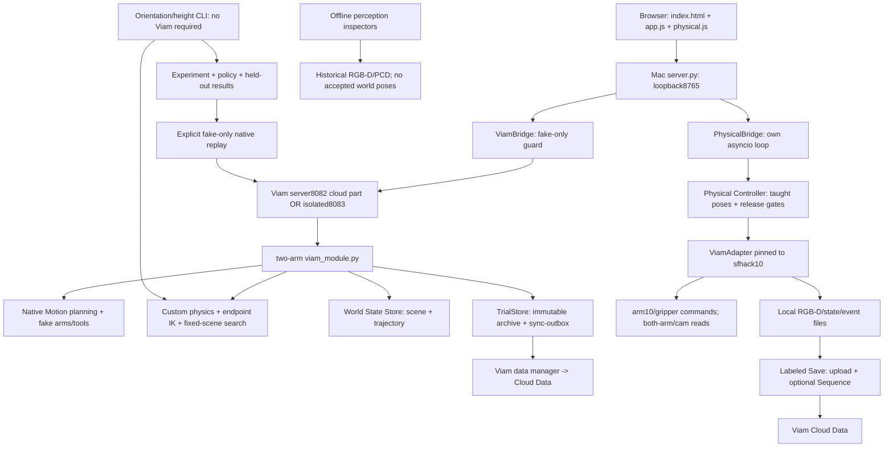

# Sircus MacBook system audit

> Repository edition of the October 29, 2026 Mac audit. Runtime findings and source references describe that audit, not current live status. The source was subsequently published to `kadiru/sircus` at `6e1fbf1`, and [Ubuntu CI passed](https://github.com/kadiru/sircus/actions/runs/41006601692). Credentials, raw observations/trials, configuration dumps, screenshots and exact host calibration records remain local. Local evidence paths below identify provenance; they are not files shipped in this repository.

Audit window: 2026-10-29 approximately 21:50–22:10 PDT (2026-10-30 UTC). Workspace: `/Users/kadirumacbook/Documents/ChatGPT/hackathon`. This report inventories the implementation on disk and uses read-only process, HTTP, browser and saved-artifact observations. No training, test replay, actuator command, service restart, deployment, configuration save or application-code edit was performed. Browser actions were view selection, expanding existing controls and reading/copying configuration.

Read alongside [all UI/API contracts](MAC_UI_API_CONTRACTS.md) and [next learning integration plan](MAC_LEARNING_INTEGRATION_PLAN.md). Detailed source line references and evidence provenance are included below. Reports supersede stale runtime descriptions in older README/STATUS files; those older files are preserved unchanged.

## Executive findings

1. The Mac runs one Sircus HTTP dashboard process: PID48391, loopback8765, hardware mode. The current physical view is **disconnected**, showing old arm state and an old completed practice trial; only Stop is allowed. Camera GET times out. Separately, Viam's web UI reports **sfhack10 ONLINE / MACHINE PART LIVE**, and its RealSense resource READY. This is a client/readback/media failure, not proof the physical machine is offline. Root cause is not established by this audit.
2. No Mac viam-server process or listener8080/8081/8082/8083 was observed. Viam shows **sircus-sim OFFLINE**, consistent with dashboard simulation GET503/connection refused. No runtime was started to obtain a prettier screenshot.
3. The physical operator workflow exists and has been used:19 saved hardware trial records (18 completed,1 aborted), all unlabeled and cloud upload deferred. It can perform the taught loading/drop cycle from one operator button, with2s loading and settling. It commands arm10 and its two-finger gripper only. No physical board-orientation or suction control exists in this dashboard.
4. The current simulator is custom Python compliant-board numerical physics plus fake Viam arms and native motion planning. Its fixed-scene searches are not a generalized learned policy. A newer CLI searches roll/pitch/gap, but the dashboard's Learn release button still searches U/V/gap at one board pose. Preserved legacy xArm6 code includes an affine fitted landing model, which is a different system.
5. Board/bucket/ball localization is not operational. Historical RGB/depth acquisition and browser point cloud worked, but current preview/readbacks fail. Configured wrist-camera transform is not verified calibration. Taught flange poses exist; calibrated metric release-height reference and min/max limits do not.
6. The proposed learning study needs a scene/action/outcome contract and headless episode interface first. Present capture retention is0.2s, not1s. Scene-conditioned learning, parallel rollouts, checkpoint inference and whole-scene test splits are absent. Signed-zero hashing currently rejects an otherwise numerically equivalent bucket policy.
7. Git is local `main` at `6e1fbf1611a49bba0eeaadde0ce7f0f9c6ccc03f`. Tracked working tree was clean at start. The private `https://github.com/kadiru/sircus` exists, but remote refs are empty: the prior push was rejected for missing workflow permission. Automated Ubuntu CI has not run. This audit does not resume the permission/change task.

## Evidence classes and limitations

- **Live observed:** process/port metadata, dashboard DOM/screenshots, read-only HTTP responses, Viam Configure status and saved JSON. This confirms UI/service state at a moment, not successful motion or calibrated geometry.
- **Source implemented:** routes, SDK calls, simulation algorithms, guards and state machines read from files. The running Python process began before some source additions; disk source is not automatically proof an old process reloaded it. Static JS is served from disk on page load, while existing browser bundles can remain loaded.
- **Historical tested:** timestamped local outputs and prior trial/evaluation records. They are not fresh audit experiments. Previous80 mock/numerical tests plus orientation contract checks passed during repository preparation; no tests were rerun here.
- **User supplied / provisional:** supplied dimensions and camera mounting facts versus assumed offsets, dynamics, placement and calibration. The Ubuntu0/100 result is supplied by the user; its raw artifacts were not found on this Mac.

Evidence folder: `handoff/mac-ui-audit-evidence/`. `physical-status.json` has the action token redacted. Its top-level connected=false is authoritative for current panel gating; nested capabilities.connected=true is older discovery metadata. Robot timestamp04:11:24Z and latest completed trial03:32Z are stale relative to this audit. The cached `is_moving=false` is not a fresh physical pose observation.

## Applications, services, URLs and exact launch paths

Commands below are documentation only; none was executed in this audit. Run from repository root unless specified. No automatic launcher is established: prior metadata says manual detached launch; a content scan found no matching Sircus/Viam/hackathon plist in user/system LaunchAgents/LaunchDaemons. Other schedulers were not exhaustively inspected.

| Application | Current observation | UI / transport | Source and startup |
|---|---|---|---|
| Combined dashboard + physical SDK worker | Running PID48391, parent1, hardware mode; physical readback unavailable | `http://127.0.0.1:8765/`, physical panel `/#physical`; single server, not two apps | `sircus/simulation/.venv/bin/python sircus/simulation/server.py --port 8765 --physical-mode hardware`; server.py PhysicalBridge owns its asyncio thread/controller |
| Cloud-bound two-arm simulation | Stopped/not observed on Mac; cloud OFFLINE | localhost8082; Viam sircus-sim3D/configure page | `sircus/two-arm/start-viam-server.sh` launches pinned Mac binary and cloud identity; `run-module.sh` is server-managed Python module entrypoint |
| Local fake-only two-arm simulator | Not running,8083 absent | localhost8083, no cloud identity or uploads | `./start-local.sh`; `build_config.py` generates fake-only test config; server launches `run-local-test.sh` |
| Local fake-only dashboard variant | Not running; use alternate8767 on this Mac to avoid8765 | `http://127.0.0.1:8767/` when explicitly launched | `sircus/simulation/.venv/bin/python sircus/two-arm/local_dashboard.py --port 8767`; overrides simulation bridge, physical backend remains disabled |
| Legacy standalone dashboard physics | Not running as current backend | Same web assets; explicit --offline at a chosen free port | `sircus/simulation/server.py --offline --port PORT`; legacy one-arm/floating-board engine, not current two-arm mode |
| Legacy standalone native850 module | No process/listener8080 | loopback8080 | `sircus/simulation/start-viam-server.sh`, `viam_module.py`; not the active two-arm module |
| Yesterday fake xArm6 replay | No process/listener8081 | loopback8081 | `sircus/yesterday-replay/start-viam-server.sh`, `demo_module.py`, `local_guard.py` |
| Legacy cloud xArm6 replay | Inactive, superseded by two-arm | Reuses sircus-sim identity/8082 historically; mutually exclusive | `sircus/viam-cloud/start-viam-server.sh`, `demo_module.py`, `cloud_guard.py`; never launch concurrently under same part |
| Numerical orientation/height experiment | CLI implemented; no active trainer observed | No HTTP/server required | `sircus/simulation/.venv/bin/python sircus/two-arm/train_orientation_height.py ...`; `replay_orientation_height.py` is a separate fake-only native replay |
| Perception tooling | Batch capture/inspection scripts, no active perception service observed | sfhack10 SDK reads or saved files | `sircus/perception/capture_stationary.py`, inspect_*.py; CLI flags documented in CAPTURE_README.md |
| Physical machine runtime | Viam reports online; remote OS/processes not inspected | sfhack10 Viam address; resources listed below | Hosted on robot-side computer, not Mac viam-server. Mac adapter is a client |
| Slides/presentation and imports | Files/artifacts, not running application services | Google Slides independently hosted | `sircus/.build`, presentation-* and output/assets; `imports/` transferred historical source; excluded from UI source archive where duplicated/unrelated |

The only observed Sircus TCP listener is127.0.0.1:8765. Process/port evidence is `handoff/audit-runtime-processes.txt`. No claim is made about unrelated Mac services, remote Ubuntu processes or all remote robot OS jobs. The user describes an Ubuntu desktop with two GPUs; GPU models, memory, drivers and current jobs were not inspected.

## Repository and files outside Git

Git remote fetch/ls-remote succeeded read-only and returned no heads. Local source commit contains119 files. No source changes or commits are made by this audit. New audit reports/snapshot live under ignored `handoff/`. Existing ignored files include meaningful legacy implementation (`viam-cloud`, `yesterday-replay`), local hardware calibration, observation and trial data, historical training policies, generated cloud configurations, screenshots, credentials and virtual environments. A clean `git status` does not mean these are absent. The snapshot includes relevant ignored **source** and selected sanitized historical policy evidence, but excludes credentials, environments, queues and raw sensor datasets. It is not just `git archive`.

## Component/data-flow architecture

The8082/8083 simulation nodes above are implemented architecture, currently stopped on this Mac. Physical adapter exists but current readback is failing. Viam Cloud does not execute Python physics merely because a machine appears in the Fleet UI.

### Frontend/backend and behavior separation

- `sircus/simulation/web/index.html` defines the shared shell and simulation controls; `app.js` handles Three.js rendering, scene edits, status polling and simulation actions. `physical.js` dynamically inserts a separate physical panel with own polling/action/recording/calibration flow. `style.css` styles both. VendorThree.js/OrbitControls and licenses are shipped locally.
- `server.py` uses ThreadingHTTPServer, JSON routes, simulation command lock and a separate async physical bridge. It is a local operator app, not a multi-user distributed job service. Simulation disconnection has no automatic offline fallback.
- Simulation fake-arm operations go through guarded generic controller commands and Viam Motion. Physical operations go through an independent controller/adapter hard-bound to sfhack10. Reading the two-arm simulated scene does not update physical board/bucket or teach poses.
- Stop physical cancels this panel's pending task and stops dropper motion; it deliberately does not open either tool or release suction. Simulation Stop cancels fake-module tasks; Pause replay only changes browser animation. The complete distinction is in MAC_UI_API_CONTRACTS.md.
- Practice mode retains each completed physical cycle locally without forcing labels; it does not start an unbounded auto-repeat loop. One operator button press starts one cycle. Acknowledged open state can skip redundant opening, but does not prove jaw position or account for commands made elsewhere.
- Physical loading is operator-assisted; no ball detector/pick planner or suction/board-control UI exists. Physical camera preview is not a live localization pipeline. No checkpoint/model import control exists.

### Shared versus duplicated code

Genuinely shared: dashboard shell/server, Viam SDK, source tree, nominal measurements, simulator scene fields, common850 kinematics/models within current two-arm stack. Simulation rendering and numerical bucket contact/clearance derive dimensions from the same scene. Physical board asset and taught poses are separate files and conventions.

Duplicated: legacy simulation/physics.py and two-arm/physics.py; old xArm6 learning/scene modules copied between yesterday-replay and viam-cloud; local numerical IK versus Viam's native planner; physical and synthetic trial schemas/storage; provisional physical and simulated tool/frame geometry. No shared learned-policy abstraction bridges physical and simulation actions today. Resource names differ (`arm-10/arm-14` versus `arm/arm-board`). A source update is not deployment to an already-running process or a guarantee all copies changed.

## Fresh read-only verification

| Check | Result | Limitation |
|---|---|---|
| Process/listeners | PID48391 hardware dashboard; only8765 for Sircus | Point-in-time Mac process snapshot |
| GET /api/physical/status |200; connectedfalse, idle, allowed[stop], cached state |No fresh joint validation; nested discovery data may be stale |
| GET /api/physical/camera |503; physical service timed out |No new image available; no restart/reconnect attempted |
| GET /api/status |503; Errno61 connection refused |No fallback or training started |
| Physical UI |Disconnected, preview unavailable, movement/release controls disabled |Viewed only; no control execution |
| Simulation UI |Disconnected, no populated scene; training/run disabled |Empty/pending labels are initialization failure, not lost measurement data |
| Viam sfhack10 |ONLINE / partLIVE; current saved config read |Not proof SDK media/motion succeeds |
| Viam camera config |READY; frame/attributes read; media unavailable0fps |Not new calibration or RGB-D acquisition |
| Viam sircus-sim |OFFLINE; current configfake arm10/14 +scene+data modules |No runtime validation |
| Git |main6e1fbf1, clean tracked tree, remoteempty |Workflow permission still unresolved from earlier task |

Screenshots: physical panel (`mac-ui-audit-evidence/physical-dashboard.png`, local evidence only), simulation panel (`mac-ui-audit-evidence/simulation-dashboard.png`, local evidence only), sfhack10 online (`mac-ui-audit-evidence/viam-sfhack10-online.png`, local evidence only), simulation offline (`mac-ui-audit-evidence/viam-simulation-offline.png`, local evidence only). Configuration snapshots are sanitized, and sfhack10 raw JSON does not expand inherited fragments. Camera fragment was separately inspected in the builder.

## Next milestone and stable stopping point

Recommended bounded milestone: define a versioned shot/scene/outcome interface, implement a headless reset/step wrapper around the existing physics, and a reproducible randomized-scene benchmark with whole-scene holdout and explicit one-second retention. Keep orientation/height search as the baseline controller. Only then select RL/dynamics training/backend migration from measured bottlenecks. In parallel, a separately authorized physical task should diagnose dashboard readback/media, establish metric reference/limits and verify camera/object transforms before new motion. Details and acceptance criteria are in MAC_LEARNING_INTEGRATION_PLAN.md.

This audit leaves PID48391 and all hardware/configuration unchanged. It restores the dashboard to its original physical view. No posts to action routes, training, job cancellations or code deployments occurred. The source snapshot includes launch scripts for inspection, but unpacking it is not authorization to start hardware or a duplicate cloud identity.

## Detailed robot, sensor and asset inventory

The following appendix incorporates the sensor audit so this document is self-contained.

# Sensor, robot and asset audit evidence

Audit date: October 29, 2026, America/Los_Angeles. This report reads existing files only. No SDK connection, configuration edit, training, motion or tool command was executed for this sub-audit. Historical snapshots below are not a new assertion of live cloud configuration or physical pose. Root audit supplies current runtime observations separately.

## Physical mappings and ownership

| Role | sfhack10 resource | Configuration / path | Status of evidence |
|---|---|---|---|
| Machine | sfhack10 / sfhack10-main | Machine `3103375b-9bab-4222-825d-b3fb9b2897fa`; part `29154d15-3b8c-4097-a3c6-2bc9d04a6e12`; cloud address `sfhack10-main.ty1cywh7tq.viam.cloud` | Hard-pinned adapter constants, `sircus/physical_trials/viam_adapter.py:22` |
| Dropper 10 | `arm` | `viam:ufactory:xArm850`; controller LAN `.231` (`192.168.1.231`) | Prior Configure UI and captured runtime model |
| Board holder 14 | `arm-board` | same arm model; controller LAN `.206` (`192.168.1.206`) | Latest retained board-asset config |
| Dropper tool | `gripper` | UFACTORY two-finger gripper; parent `arm`; adapter uses only this tool | Prior expanded Configure UI; adapter lines128–138 |
| Board tool | `vacuum-board` | `viam:ufactory:vacuum_gripper`; attributes `arm=arm-board`, `connection_type=contact`; user identifies physical tool as AS1200 | Configured tool proxy is not a measured AS1200 mesh |
| RGB-D | `cam` | RealSense D435; user-confirmed arm10 tool bracket, unchanged; assigned device serial matches the photo label (serial omitted) | API status and phone evidence from earlier work |
| Motion | `builtin` | Viam Motion service; GetPose returns world-frame flange poses | Adapter lines160–179 |
| Nominal board | `sircus-board-provisional` | generic/fake primitive attached to `vacuum-board` | Installed and frame/geometry verified at02:16Z Oct30 |

The physical adapter creates handles for both arms but only commands `arm` and `gripper`; `board_commands=false`. It does not expose a suction-handle command path. Its two-arm state reads use parallel separate RPCs for joints, IsMoving and Motion.GetPose, not exposure-synchronized samples.

The earlier standalone **sfhack14** machine (machine `5e5701f5-ebbb-48ba-96ff-f3771ffe9f38`, part `334db4e2-157d-41ce-ab34-efb468467141`) also references controller192.168.1.206 as its `arm`. The last retained browser verification at2026-10-29T23:52:59Z said sfhack14 OFFLINE while still retaining that configuration. This does not establish its status now or exclusive board-arm ownership. Do not activate another controller against it by inference.

Sources: `sircus/hardware-observed/inventory.json` (older1370mm spacing), `hardware-observed/handoff-20261029/{sfhack10.json,sfhack14.json,physical-verification.json}` (updated spacing), `physical_trials/evidence/board-asset/sfhack10-after.json`, `physical_trials/evidence/connection-repair/readbacks/readbacks.json`. Top-level saved machine JSON includes fragments and is **not the full expanded configuration**. Runtime `configured_frames.json` and expanded UI records are needed for inherited arm/camera/table details. The last retained inventory included a shell service `ViamShellDanger`; it was neither used nor treated as an orchestration API in this audit.

## Physical frames and collision geometry

All translations/dimensions below are millimeters. Pose orientations are Viam orientation vectors plus angle unless noted. The retained runtime frame snapshot is `sircus/perception/data/20261030T001623700791Z/configured_frames.json`; later board asset verification is `sircus/physical_trials/evidence/board-asset/runtime.json`.

| Frame / geometry | Parent | Translation / orientation | Geometry and provenance |
|---|---|---|---|
| `arm` base | world | identity | URDF-derived articulated model;6 joints,7 links, mesh collision geometry in retained frame snapshot |
| `arm-board` base | world | [1337.31,0,0], yaw180° | User52.65in spacing; interpreting reference as base-to-base X and retaining Y/Z/yaw are assumptions |
| `gripper` | arm | [0,0,105], identity | Case box75×110×110 at localZ−55; claw box45×120×112 at localZ−6; driver proxy, not independent metrology |
| `vacuum-board` | arm-board | identity | Box70×93×117 centeredZ58.5; tube5×5×5 centeredZ117; front119.5 |
| `sircus-board-provisional` | vacuum-board | [0,0,122], yaw+90° | Box200×300×5, user-measured size; centered offset and122mm are derived from tool proxy, unmeasured |
| `cam` | arm | [83,−14,18]; OV[−0.0303909947,−0.0035379994,0.9995318254], θ−97.731173° | Camera box90×25×25 centered locally[32.2,0,−8.3]; inherited, unverified extrinsic |
| `table` | world | [0,0,−123], identity |3000×3000×200; topZ−23; inherited proxy, not newly measured |
| `ceiling` | world | [0,0,1050], identity |3000×3000×100; bottomZ1000; inherited proxy |
| `wall-back` | world | [−550,0,488], identity |50×1500×1024; inherited |
| `wall-left` | world | [0,450,488], identity |1500×50×1024; inherited |
| `wall-right` | world | [0,−750,488], identity |1000×50×1024; user-directed edit fromY−450 andX dimension1500; no metrology claim |

Walls/table/ceiling use obstacle-model resources whose API subtype is `gripper`; that resource type does not mean a physical jaw should be actuated. The physical arms’ retained attributes include speed60deg/s, `use_urdfs=true`, `collision_sensitivity=0`; this is an observed configuration value, not a tested safety/clearance conclusion.

Physical board shape is **not display-only**: component `frame.geometry` contributes to the frame-system planner. Its local impact face isZ+2.5, normal+Z; nominal vacuum-frame impact centerZ124.5. Its pose is uncalibrated. No board bending/suction compliance is represented by this rigid collision primitive. No perception-estimated board frame exists; proposed `sircus-board-observed` is a future name only. No physical bucket collision geometry is present in the latest retained board-asset config. No physical ball tracking asset is present. A good visual overlay does not certify these poses or collisions.

References: `physical_trials/assets/board.json:1`, `physical_trials/board-asset-notes.md:1`, `physical_trials/verify_board_asset.py:1`. That verifier reads frame system/transform pose/joints only; its historical output records stationary brackets and successful geometry checks, not movement tests.

## Shared measurements versus simulation assumptions

Canonical measurement record: `sircus/measurements.json`; simulation scene: `sircus/two-arm/scene.json`.

- Board200×300×5mm and90° landscape correction are user-supplied. Board localU/X stays200 andV/Y stays300; applying+90° mount rotation changes tool-frame footprint to300×200. Do not also swap local dimensions. +90° sign is a convention, not measured axis registration.
- Base spacing1337.31mm is converted from52.65in; axis/reference interpretation is provisional.
- Bucket inner diameters177/150mm, outer200/158mm are user measurements.175mm is **reported height** with overall-height/interior-depth meaning unresolved. Simulation provisionally uses175mm interior depth plus8mm unmeasured base, giving183mm outer height. Bucket placement remains provisional.
- ODD Ball nominal75mm/200g is supplied project information and used by simulation. No actual ball measurement or valid visual3D radius estimate was established in the saved observation work.
- Physical board mass, actual suction contact point, flange-to-board offset/normal, tool geometry accuracy and dynamics remain unmeasured. Simulation uses board0.4kg and suction offset100mm, which **differs from physical asset’s proxy-derived122mm board-center attachment**. These are distinct conventions/assumptions, not calibrated interchangeable offsets.
- Simulation world has arm14 base[1337.31,0,0], yaw180°, board center[600,0,350], RPY[0,30,90]°, bucket centerXY[680,245], floor-topZ27 (rimZ202 under assumed depth), table center[550,0,−5] size850×800×40, pickup[350,−220,52.5]. These simulation placements do not match a measured physical workcell by declaration.

## Taught physical poses and calibration status now on disk

`sircus/physical_trials/data/hardware/calibration.json` supersedes old STATUS text saying calibration was blank. It records world-frame **arm flange** poses, not ball-center or board-impact measurements:

- Both loading and drop poses were taught and saved as world-frame arm-flange poses. The board reference joints and kinematic pose were also saved. Exact pose/joint vectors and teaching timestamps are omitted from this repository edition; they remain in local hardware calibration and evidence.
- `confirmed=false`; no calibrated reference-Z or min/max release-height fields were present. The suggested10cm was not adopted as a calibrated height. Fixed-pose practice uses exact locally taught poses without claiming metric drop height; variable-height operation still needs a measured reference and limits.

Nineteen hardware `trial.json` records currently exist, spanning2026-10-30T02:58:28Z–03:32:18Z:18 statuscompleted,1 aborted; all19 saved locally, outcome=null, label_status=unlabeled and cloud.state=deferred. This confirms controller-recorded prior practice execution, **not18 bucket captures**. It supersedes earlier STATUS statements that physical workflow was wholly untested or that no hardware trials existed. No trial was created by this audit.

## RGB-D capability evidence and limits

Preferred historical capture `sircus/perception/data/20261030T001623700791Z/` was collected17:16:23–17:16:35 PDT. Three RGB/depth pairs with bracketed arm states are retained. A separate browser cloud is under `data/20261030T002549121000Z-browser-pointcloud/`.

| Capability | Actually evidenced | What remains unknown |
|---|---|---|
| Camera identity | GetStatus assigned serial (omitted), streamingtrue, physical_camera_assignedtrue; IMG9307 label matchesD435 | Configured serial filter is empty, so future device selection is not pinned |
| RGB |3 original JPEG1280×720; dashboard repair later also saved RGB frames | Current live operation must be separately checked |
| Depth |3 Viam DEP responses, big-endian raw uint16 decoded to arrays;86.82–86.99% nonzero overall | Raw counts must retain unit provenance; ball returns sparse/outlier-heavy |
| Intrinsics |fx906.8481, fy906.8774, cx651.4015, cy362.5878,1280×720; inverse_brown_conrady with five zero coefficients | Driver report, no independent calibration |
| Depth scale | Later PCD-to-depth cross-time consistency median0.00100000008m/count,96.57% within1% of0.001 | Host device scale not independently queried; no known-distance metric check |
| Alignment |Configured `align_color_depth=true`, matching output size; exact module0.22.6 source uses alignment; heuristic table-edge median4.5px offset |Not calibrated alignment error;95th percentile11.5px, ambiguous boundaries/holes |
| Point cloud |Browser GetPointCloud succeeded:921600 XYZ/RGB records,796948 positive finite points; XYZ meters from exact module source and consistency check |SDK call failed after10.7s; browser cloud is later and unpaired, exposure timing unknown |
| Joint bracket |Both arms IsMovingfalse, all returned before/after joint deltas0° |Sequential RPCs and no camera hardware sync; not proof of no between-sample motion |
| Camera-to-world |Configured arm-parent transform and kinematic GetPose available |No verified tool-camera transform/reference; no calibrated world object poses |

Image-response timestamps00:16:31.157Z,00:16:32.558Z,00:16:33.692Z refer to driver responses. Individual RGB/depth exposure timestamps, hardware synchronization and server/Mac clock synchronization were not returned/verified. Later browser cloud has no contemporaneous joint bracket. Identity internal camera extrinsics in GetProperties are not a wrist calibration.

Exact module-source provenance is saved in `perception/reference/SOURCE_PROVENANCE.json`, commit8caec2f4b60887e71b7c12d0d27fad0bff5740da. The DEP encoder copies raw counts; PCD encoder uses RealSense vertices in meters. Do not substitute generic units based on API naming alone.

## Existing reusable perception code

- `capture_stationary.py:81` connects only to pinned sfhack10 using external credentials, gathers resources/properties/frames, camera images, depth payloads, bracketed joint states and optionally PCD; writes original payloads, RPC metadata and checksums. It makes no actuator calls. Acquisition starts aroundline129; PCDline194. An SDKPCD failure can break connection, as retained attempt001321684082Z shows.
- `inspect_capture.py` decodes and summarizes raw depth offline; `inspect_browser_pointcloud.py` inspects binaryPCD and compares against earlier depth; `inspect_alignment.py` implements the heuristic table-edge comparison.
- `inspect_ball.py:85` uses color segmentation of the turquoise/green visible ball and diagnostic free-radius sphere fits; all fits are marked `accepted_as_pose=false` atline106. Output2D center mean[367.53,539.34]px and camera bearing[−0.29370,0.18287,0.93824]. Ball3D center/radius **missing**; only15.16–16.55% of mask has nonzero depth and candidates fail silhouette consistency. No assumed diameter was substituted.
- `inspect_fiducials.py:13` detects ArUco corners/IDs offline, errorCorrectionRate0, no metric solve. Historical phone board image yielded43 exact-code5×5 markers; DICT_5X5_100/250/1000 share observed prefix so dictionary not uniquely established.14 columns and14×9 chess squares are plausible, not confirmed. No markers were detected in saved RealSense frames because board is not visible there.
- Board impact plane/normal and bucket opening center/normal are **missing**, not estimated from simulation. There is no board or bucket segmentation/pose pipeline connected to the dashboard or Viam scene, and no live vision/ML service appears in retained physical inventory.

Required next measurements: chess-square pitch; marker black-border side; confirmed rows/columns/dictionary/ID layout or original print; grid origin/axes and board-edge offsets; tape/print-to-impact-surface offset/flatness; measured camera/tool transform or calibrated reference procedure; reliable depth scale/range check; real ball diameter if using size-constrained fitting; bucket height interpretation and observed opening pose; actual board/suction mount.

Historical recommendation still holds: a dimensioned matte reference target in the stationary camera field can support depth-scale/registration validation before later planned hand-eye acquisition. A single stationary view or plausible scene overlay cannot establish full wrist-camera calibration. Board/bucket must actually be in view for image-derived poses.

## Data/service distinction

The retained post-repair resource inventory has **no native data_manager, no capture-control, no vision and no ML model service**. Mac-side physical recording uses camera GetImages and both-arm snapshots, retaining source timestamps/metadata and file hashes. Optional capture-control code exists but is unconfigured; DataSync and Sequence creation on labeled Save are implemented but the19 retained practice records defer upload. Do not infer successful cloud upload or Sequence from code availability. `physical_trials/viam_adapter.py:139` controls discovery, and lines330 onward implement recording/upload logic; detailed route contracts are in the separate UI/API audit.

This report intentionally does not copy credentials, raw observations, private connection files or host calibration into a transport archive. It records the technical facts needed to plan subsequent work and distinguishes user measurements, nominal configuration, kinematic predictions, image observations and missing calibrated quantities.

## Fresh root-audit verification — supersedes live-status assumptions

The coordinating audit subsequently inspected the current Viam UI read-only. `sfhack10` showed **ONLINE / MACHINE PART LIVE**, while the local dashboard was disconnected. The current saved cloud configuration (`handoff/mac-ui-audit-evidence/sfhack10-cloud-config.sanitized.json`) confirms arm14X1337.31, wall-rightY−750 with1000mm X dimension, and the passive board parentvacuum-board/offsetZ122/box200×300×5. These are verified current saved configuration values; expanded runtime collision geometry was not re-queried in this audit.

Fresh camera Configure UI (`handoff/mac-ui-audit-evidence/camera-config-ui.txt`) showed RealSense0.22.6 READY; color/depth1280×720, big-endian DEP (`little_endian_depth=false`), alignmenttrue, emptyserialfilter; parentarm and inherited extrinsic above unchanged. Its Test GetImages view reported **Unable to play media,0fps**. Local dashboard camera GET returned503/timed out. Therefore historical successful RGB-D acquisition must not be represented as currently working live preview. The difference between Viam ONLINE/READY and client media/readback failure remains unresolved; no restart, tuning or reconnection change was made by this audit.

## Detailed physics, learning, data and policy inventory

The following appendix incorporates the learning audit; historical results remain separate.

# Learning and simulation implementation evidence

Audit: 2026-10-29/30 UTC. Read-only source and saved JSON inspection; no training, tests, replay, process start, hardware command or scene mutation was performed for this audit. Source locations below are repository-relative, with line numbers at local commit `6e1fbf1611a49bba0eeaadde0ce7f0f9c6ccc03f`. Runtime findings are supplied by the parent system audit; historical STATUS claims do not establish current activity.

## Current two-arm numerical physics

`two-arm/` below means `sircus/two-arm/`.

- Engine: custom pure-Python reduced-order simulation, not MuJoCo/Isaac/Bullet or Viam rigid-body dynamics. `two-arm/physics.py:371` executes one complete shot; there is no incremental simulator object, `reset()`/`step()` API or Gym interface. Client units are mm/degrees/kg/seconds, integrated internally in SI.
- Integration: semi-implicit Euler (update velocity, then position; support angular/normal velocity, then displacement) at `physics.py:565`. Current scene `simulation.dt_s=0.0005` (2 kHz), duration 3s, frame samples every 0.02s (50 Hz). Config validator permits 0.00005–0.001s and rejects frequency/damping combinations violating resolution bounds (`physics.py:179`). Time step validation is not a proof of physical fidelity.
- Ball: nominal sphere diameter75mm, mass0.2kg; both remain provisional in scene calibration text. Zero release velocity; gravity9.81m/s². No spin, aerodynamic drag, rolling resistance, deformable ball shape, torque control, whole-arm inertia or robot compliance. No dynamic robot-ball collision simulation.
- Contact: closest sphere/OBB or sphere/axisymmetric-bucket contact with penalty normal force `Fn = k * penetration * max(0, 1 - damping * normal_relative_velocity)` (`physics.py:433`); `k=18000N/m`, ball/board dissipation0.12s/m. Dissipation is **not** a directly calibrated coefficient of restitution. Sliding friction is capped by both μFn and one-step stopping impulse, μ=0.2. Table dissipation0.3s/m; bucket0.6s/m. These are unmeasured assumptions.
- Board: rigid 200×300×5mm, provisional mass0.4kg. One normal spring/damper (12000N/m,18Ns/m) and two tilt spring/dampers (30Nm/rad and0.15Nms/rad each). Support at board-local[0,0,0] is provisional. Nominal pose includes assumed preload/sag. Small-angle dynamics use diagonal inertia about the support; rendered rotation is composed exactly. Off-center impact torque changes support tilt and outgoing trajectory (`physics.py:478`). No plate bending, tangential support translation, yaw compliance, suction failure, or calibrated AS1200 compliance.
- A shot terminates with `model_limit` if support deflection exceeds80mm or additional tilt exceeds20°, or if moving board contacts a static clearance solid (`physics.py:453`,`:560`). It does not clip the motion and call that physical success.
- Current board center[600,0,350]mm, RPY[0,30,90]°; fixed board-body U=200/V=300. Landscape mount yaw+90°. Arm14 base[1337.31,0,0]mm and yaw180°; measured52.65in distance but axis, base reference and yaw remain assumptions. Suction tool offset100mm is provisional. Pickup[350,-220,52.5]mm; table center[550,0,-5]mm,size[850,800,40]mm (`scene.json`). These are simulator coordinates, not confirmed calibrated physical poses.

## Bucket contact, clearance and success semantics

- Inner diameters177/150mm and outer200/158mm are supplied physical measurements; straight-sided taper approximation. Reported height175mm remains unresolved (overall versus interior). Simulation explicitly assumes interior depth175mm plus unmeasured base thickness8mm, hence outer height183mm. Floor topZ27mm, rimZ202mm; provisional bucket centerXY[680,245]mm.
- Ball contact (`physics.py:265`) projects in radius/Z onto five real surface segments: underside, outer wall, rim annulus, inner wall, floor. The open top has no lid. At simultaneous contacts the simplified solver chooses the nearest solid surface normal; this is not a general multi-contact constraint solver.
- Containment uses the inner frustum, full sphere radius and sloping-wall margin `radius*sqrt(1+slope²)` (`physics.py:313`). Solver evaluation admits0.5mm numerical penetration tolerance.
- Viam/robot clearance uses **separate** conservative outer-envelope geometry (`bucket_geometry.py:15`):24 oriented wall-sector boxes plus square floor bounding box; table is another box. These boxes can shrink the usable interior but do not underrepresent the outside envelope. They are never passed to ball contact as boxes. Renderer and Viam scene read the same scene dimensions.
- `retained` currently requires full containment near floor (within3mm of sphere resting height), speed<60mm/s, and prior floor contact for **0.2s**, then ends the simulation. It does **not** verify one-second retention (`physics.py:546`). Terminal classes: `retained`, `board_miss`, `floor_contact_not_retained`, `miss`, `model_limit`.
- Contacts report surface names/time and ball position or impactUV. Clean capture versus rim-assisted capture, explicit entry/exit events, bounce-out, one-second retention and timed dwell across re-exit are not implemented. They must be derived or added rather than inferred from `first_floor_contact`.
- Reward: retained1 or first-floor0.25 or0, minus center error/1000 and minus1 for model limit (`physics.py:595`). Center error is first downward sphere-center crossing at floor+radius after board contact, falling back to finalXY; it is not necessarily final resting error nor opening-plane error.

## Kinematics and native replay

- Official pinned850 kinematic model (`models/xarm850_kinematics.json`); FK, joint bounds and provisional tool collision boxes in `kinematics.py`; world-frame base mapping and board mount in `two_arm_kinematics.py:12`.
- Endpoint IK uses SciPy bounded `least_squares`, six initial guesses, up to220 evaluations each, positional residual plus120×rotation-vector residual. Reachable threshold2mm and0.02rad (`two_arm_kinematics.py:53`). Cache size1024. Board14 target and seven dropper waypoints are checked. These are **not collision-checked trajectories**.
- Board target is center plus rotated support offset minus half thickness; requested suction orientation removes board mount yaw (`two_arm_kinematics.py:27`). Dropper stays downward. Sequence: approach, descend, lift, transfer, release, retreat, reset (`:88`). Numerical optimizer does not actually grasp a physical ball.
- Native Viam module (`viam_module.py:285`) calls `MotionClient.move` for suction14 with attached board geometry and table/bucket clearance. It verifies TCP readback≤2mm and board orientation≤1°. Then seven gripper10 waypoint moves with static board/table/bucket obstacles and held-ball attachment; readback≤2mm/downward orientation (`:328`). This is eight successful motion checks when all succeed.
- Fake gripper attachment and ball trajectory are modeled. Native replay computes bounce offline and plays frame transforms; native motion success does not validate bounce dynamics or real arm accuracy. Board motion does not run inside the contact integrator.
- Native controller accepts one task, guarded fake-only config, stop cancellation, explicit scene persistence and archived replay results. `set_scene` may move fake14 and write `scene.json`; it is not a harmless read-only method. Strict native base/tool frames are fixed (`viam_module.py:32`). Numerical candidate evaluation can vary board pose without that live scene mutation.

## Current optimizers: no generalized learned policy

| Implementation | Inputs/actions | Search/evaluation | Storage and scope |
|---|---|---|---|
| `two-arm/training_loop.py:60` (dashboard Learn release) | One complete fixed scene; choose U,V,gap | Eight coverage proposals, then bounded random exploration and Gaussian refinement around best; budget8–80 (UI24). Both-arm endpoint IK; numerical bounce. 10 independent small-noise evaluations after freeze (±2mmXY/±3mmgap); defaultseed42 | `sircus-two-arm-release-v1` with one `best_action`, fixed board pose, scene/source fingerprint; not scene-conditioned inference or RL |
| `two-arm/train_orientation_height.py:65` (new CLI) | Fixed board center, yaw, bucket and world releaseXY; choose roll,pitch,gap | Budget4–500, default32; first candidate seeds current board roll/pitch and gap161.715, then random first half/local Gaussian refinement. Defaultroll[-20,20],pitch[10,50],gap[60,380]. Recomputes U/V from vertical-line/contact-plane intersection to preserve worldXY. Both-arm endpoint IK; tests1–100(default10) after freeze, ±2mmXY/±3mmgap | `sircus-orientation-height-v1`: parameters, releaseXY, reconstructed selected scene/action, source contract fingerprint. CLI only. New unique experiment directory; no Viam/cloud needed |
| `simulation/learning.py:23` (legacy offline dashboard) | One-arm/floating-board fixed scene U,V,gap | Similar random/local search; single-arm IK;10 perturbation tests | `sircus-compliant-release-v1`, `simulation/runs/`; old rectangular scene and different engine, not current two-arm backend |

Current CLI candidate contract is narrower than the accepted next task: impactUV is solved to preserve fixed worldXY, not independently optimized; board yaw is fixed; bucket is upright withXY+floor height, not arbitrary opening6D pose. No scene sampler, persistent learned weights, cross-scene held-out split, gradient optimizer, replay buffer, PPO/SAC, Gymnasium or neural inference service exists in these current paths.

## Saved evidence and compatibility

Read-only file inspection found these separate two-arm training archives (not rerun):

| Archive under `sircus/two-arm/data/archive/` | Scene | Proposals | Saved held-out result | Best U,V,gap mm |
|---|---|---:|---:|---|
| `20261029T221710985100Z-2e8a0a4a` | Rectangular, boardRPY[-30,0,0] |8|10/10|0,50,140|
| `20261029T221947799789Z-282ce37b` | Rectangular, boardRPY[-30,0,0] |24|10/10|0,50,140|
| `20261029T232904069256Z-2a7bbd1f` | Tapered bucket, landscape boardRPY[-0,30,90] |24|10/10|-16.4082398,-44.8207486,161.7152240|

These are synthetic captures at a single fixed pose and small release perturbations, not generalized success. Separate earlier `simulation/runs/` policies also exist. New orientation/height smoke evidence is `handoff/sircus-varun-ubuntu/evidence/orientation-height-mac-smoke/{policy,summary,experiment}.json`:4 valid candidates,2/2 synthetic retained; selectedroll-0,pitch30,gap161.715. It reproduced the seeded solution, not evidence of learning a better one. Native replay evidence is adjacent `evidence/native-replay-mac.json`. No `sircus/two-arm/experiments/` directory existed at audit.

**Ubuntu0/100 is a user-reported separate height-only fixed-scene experiment with persistent lateral miss; its artifacts were not independently located/verified on this Mac in this audit.** Never pool it with the above rectangular/bucket or new orientation smoke results.

`trial_store.py:25` hashes complete scene JSON plus physics, bucket geometry, training loop, kinematics, two-arm kinematics and arm model; `bucket_clearance.py` is optional in hash list and absent here. Viam module, proxy tool files, dependency versions and outcome-contract schema are not all covered by this fingerprint. Orientation CLI adds its own source hash (`train_orientation_height.py:29`). Cache loader (`policy_cache.py:8`) requires matching summary/policy fingerprints, schema, action, complete history and10 test rows. Scene changes invalidate replay/cache; evidence remains immutable.

**Observed compatibility edge case:** current source/scene fingerprint recomputed from file bytes is `6fd707201f24c682b552bebdacb25ef9f203544a01b9676b6380554fca455700`. All three archived fixed-board policy fingerprints differ. The bucket archive has `bb6bc13e1d38ac1bba4d12b11f3c249396e06acd4540097bfcbb3455706c30eb`; every saved source hash matches current source and scene objects compare numerically equal, but archived board roll is `-0.0` and current roll `0.0`. Canonical JSON preserves signed zero, so the otherwise equivalent bucket policy is skipped. This is false incompatibility from serialization, not evidence the contact model changed. No policy or guard was changed during the audit.

## Logging/replay and reuse boundaries

`TrialStore` publishes JSON atomically and immutably into `two-arm/data/archive/<session>` and disposable duplicates into `data/sync-outbox`. Schema `sircus-two-arm-trial-v1`: session/record IDs, UTC, fingerprint, origin=synthetic, role IDs, per-trialphase/seed/action/config, reward/retained/outcome, impactUV/region, feasibility, contact/support/energy telemetry and full result. Phase=train/test/native/manual; source/evaluation fingerprints distinguish noisy evaluation scene. State store reports upload unverified; disappearance from outbox alone is not cloud confirmation.

Orientation CLI instead writes plain experiment/train/test/selected-scene/policy/summary files outside TrialStore, without cloud copies. `replay_orientation_height.py:7` verifies its policy, connects only guarded local8083, sets selected scene, runs native fake sequence and writes native-replay separately. Current UI cannot select arbitrary model checkpoints; it restores its compatible fixed-board result or downloads displayed run JSON.

Physical data path is a separate `physical_trials` controller/adapter, local frames/state/metadata plus Viam upload IDs/optional sequence creation. It does not run the two-arm simulator's policy. Shared concepts: frontend shell, units, asset dimensions, Viam SDK and source tree; independent implementations: physical state machine, real tool commands, taught poses, physical recording schema, and calibration. Matching human role10/14 does not make raw RPC component names interchangeable.

## Preserved legacy systems not to overlook

Ignored `sircus/yesterday-replay/` and `sircus/viam-cloud/` retain the imported original fake xArm6 demo:40mm ball,30° rigid ramp, rectangular bin. They are **not** the current850 two-arm learner. Historical STATUS runtime claims are stale; parent runtime audit found no8081/8082 listener.

- `scene_spec.py:186`: idealized gravity/frictionless sphere-plane restitution0.8, then first box contact; collision candidates at240Hz and bisection, not compliant spring dynamics. `preview_with_edge_rebound` permits one extra edge rebound and stops; no rolling or retention.
- `learning.py:65`: `AdaptiveSearch` genuinely fits a small affine action→landingXY model from uncensored floor contacts, after five coverage probes; inverse fit proposes dx/gap; bounded fallback grid;6–16 trials and three deterministic sensitivity checks. This is real fitted regression in a legacy demo, not a generalized current two-arm policy. `adapt` can transfer its fit to known bin coordinates.
- `robust_learning.py:44`: observation-callback search with48 shared training perturbations (XY±3mm,height±5mm,restitution0.72–0.88), historical miss direction, wide/random proposals and staged elite refinements; five finalists evaluated on60 separate selection perturbations; reserved test seed unused for selection. No neural weights.
- `multi_adaptation.py:17`: three predefined translated-bin cases,10 outcome-driven proposals,24 training noise samples,48 selection,20 test; known manual geometry transfer.
- `layout_adaptation.py:18`: three declared ramp/bin layouts,12 proposals including broad gap sweep andY/gap refinements; no automatic perception.
- `demo_module.py:90`: legacy `probe/status/learn/adapt/run_best/move_bin/set_layout/position_adapt/layout_adapt/noise_test/training_demo/noise_next/stop` orchestration, manual capture gating, per-run/CSV/JSON state; not exposed by the current Sircus HTTP dashboard. It has scene fingerprints and restart interruption handling. Frozen scene/layout and saved traces are historical.
- Copies in yesterday-replay and viam-cloud differ in environment guards/binding; physics/learning modules are duplicated. Legacy850 `simulation/physics.py` also duplicates much of compliant dynamics but has only rectangular target support. Do not fix one file and assume all backends changed. Consolidation must be explicit and preserve baseline evidence.
