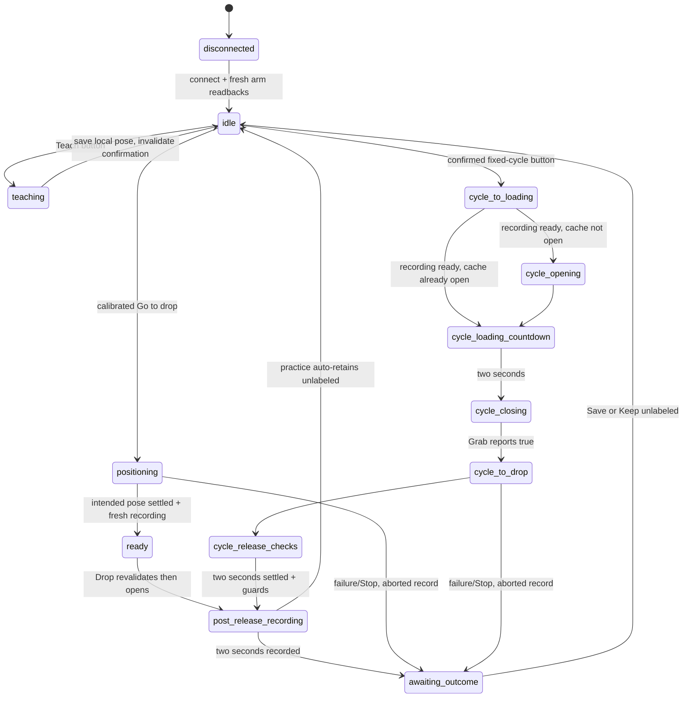

# Sircus Mac UI and API contracts

> Repository edition of the October 29, 2026 Mac audit. Runtime findings and source references describe that audit, not current live status. The source was subsequently published to `kadiru/sircus` at `6e1fbf1`, and [Ubuntu CI passed](https://github.com/kadiru/sircus/actions/runs/41006601692). Credentials, raw observations/trials, configuration dumps, screenshots and exact host calibration records remain local. Local evidence paths below identify provenance; they are not files shipped in this repository.

Audit date: 2026-10-29. Workspace: `/Users/kadirumacbook/Documents/ChatGPT/hackathon`. Source revision inspected: `6e1fbf1611a49bba0eeaadde0ce7f0f9c6ccc03f` plus the working files at audit time. This is a **read-only source audit**; no buttons that actuate hardware, no POST routes, no training, and no application tests were executed for this report. Live service availability and screenshots are documented in `MAC_SIRCUS_SYSTEM_AUDIT.md`. “Implemented” below means a complete source path exists, not that this audit physically exercised it.

### Timestamped runtime cross-check supplied by the main audit

The existing dashboard process PID48391 serves loopback8765 with `--physical-mode hardware`. During this audit, `/api/physical/status` reported **connected=false**, phase idle, readback unavailable, and only Stop allowed. Its robot payload was cached (timestamp04:11:24Z), so those joint/pose values are **not fresh state**. The Viam cloud page independently showed sfhack10 ONLINE/LIVE; dashboard failure does not establish robot-server outage. Simulation UI reported connection refused. The last retained trial was a completed, unlabeled practice trial. No reconnect or actuator action was attempted. Consequently motion/recording/training controls documented below are **source-implemented but not currently proven available**; hardware action controls were locked by the reported connection state. Evidence: `mac-ui-audit-evidence/physical-status.json`, `physical-dashboard.png`, `simulation-dashboard.png`. Camera availability is evaluated separately by the main audit, not inferred from an old preview.

All source references are project-relative `file:line`. The snapshot preserves those source files. Historical tests and operator successes are separate evidence from the current source inventory.

## 1. Environment boundaries and entry points

| UI / execution mode | Implementation and selection | Target | Physical actuator effects |
|---|---|---|---|
| Simulation tab | `sircus/simulation/web/index.html:16`; `physical.js:196` toggles the two panels | Whatever simulation backend was selected when the process started | No physical target in the intended guarded configuration |
| Physical trials tab | `index.html:17`; `physical.js:196`; direct URL fragment `/#physical` | Independently configured physical backend | Selecting tab only starts status/camera reads; action buttons can move hardware |
| Default simulation backend | `server.py:75`, `server.py:302`; process without `--offline` | Local `127.0.0.1:8082`, pinned cloud part for `sircus-sim` (`5db5a9df-2e56-4711-9d39-b42cc86e4d79`) | Guard requires two fake arm drivers and fake grippers, correct module/part; rejects remotes |
| Local fake-only simulation backend | `sircus/two-arm/local_dashboard.py:1`; `local_client.py:9` | Credential-free loopback `127.0.0.1:8083`; cloud sync disabled | Simulation only; probe and config guard required |
| Legacy standalone simulation | `server.py --offline` | Local `sircus/simulation` physics and kinematics; no Viam | Numerical/visual only, older scene implementation |
| Physical disabled | Default `--physical-mode disabled` | None | Physical API returns unavailable |
| Physical dry run | `--physical-mode dry_run`; `mock_adapter.py:9` | In-memory mock state and synthetic SVG camera | No SDK, no physical connection |
| Physical hardware | `--physical-mode hardware`; `viam_adapter.py:108` | Pinned `sfhack10-main.ty1cywh7tq.viam.cloud`; machine `3103375b-9bab-4222-825d-b3fb9b2897fa`, part `29154d15-3b8c-4097-a3c6-2bc9d04a6e12` | Only arm `arm` and two-finger `gripper` commanded by adapter; `arm-board` read only; no vacuum handle |

The environment tabs are **not a hardware/simulation connection switch**. Both frontend modules load in the same document; process flags create independent backend bridges. Switching tabs does not stop simulation jobs, close connections, reload calibration, or stop a physical action. The simulation module can continue its status polling while the physical view is selected. The physical status/camera polling is conditional on physical-tab selection; backend robot polling is independent of tab visibility.

The default dashboard binds to `127.0.0.1:8765` (`server.py:305`, `317`); `--port` can change that. `local_dashboard.py --port` uses the same default. A local fake-only instance does not enable a physical backend (`server.PHYSICAL` stays `None`). Startup commands in the system audit are documentation only; no service was started for this audit.

## 2. Complete control inventory

Status vocabulary: **I** = implemented source path; **M** = mocked when physical backend is dry-run; **N** = absent; **U** = current runtime functionality not exercised in this source audit. A hardware “yes” refers to hardware mode only; dry-run uses the same controller with a mock adapter.

### 2.1 Navigation, scene display, and simulation controls

| UI label / element | Source location | Request or local behavior | Target and side effects | Status |
|---|---|---|---|---|
| Simulation / Physical trials tabs | `index.html:15`; `physical.js:196` | DOM visibility, ARIA flags; physical selection triggers status then camera GET | UI only; no action command | I/U |
| Connection badge | `index.html:13`; `app.js:166` | Renders `connection.backend`, `connected`, optional `label` | Displays VIAM SIMULATION, LOCAL FAKE-ONLY, OFFLINE SIMULATION, or DISCONNECTED; not a selector | I/U |
| Two-arm 3D scene | `index.html:24`; `app.js:97`, `120`, `145`, `251` | Three.js renderer; arm link boxes from readback; table, board, ball, tapered/rectangular target meshes | Visual scene; mm converted to m; readback geometry and synthetic trajectories, not camera reconstruction | I/U |
| Drag to orbit / scroll to zoom | `app.js:251` | Three.js OrbitControls | Camera only | I/U |
| ↺ View | `index.html:27`; `app.js:250`, `328` | Resets viewer camera/target | Does not reset scene, trial, robot, or policy | I/U |
| Top | `index.html:27`; `app.js:328` | Sets viewer camera to top-down | Camera only | I/U |
| Speed ½× / 1× / 2× | `index.html:27`; `app.js:237` | Multiplies local recorded replay clock | Does **not** set robot speed or native Viam task playback speed | I/U |
| Board X, Y, Z | `index.html:42`; `app.js:16`, `261` | Edits `config.board.center_mm`; local preview immediately; sent on Apply/Run/Learn | Simulated board; later Apply/Run/Learn moves fake arm 14 | I/U |
| Board Roll, Pitch, Yaw | `index.html:43`; same field mapping | Edits `config.board.rpy_deg` in degrees | Same staged scene change; no physical board control | I/U |
| Baseline | `index.html:44`; `app.js:329` | Restores board center/angles from `initialConfig` captured at connect or external scene update | Local preview; not a universal historical baseline reset | I/U |
| Turn 15° | same | Adds 15 to board yaw | Local preview; subsequent Apply/Run/Learn positions fake arm 14 | I/U |
| Raise 50 mm | same | Adds 50 to board center Z | Local preview; subsequent Apply/Run/Learn positions fake arm 14 | I/U |
| Target bucket/container X, Y | `index.html:46`; `app.js:19`, `261` | Edits `config.bin.center_xy_mm` | Local preview then explicit scene apply; floor Z/dimensions require JSON | I/U |
| Bucket measurement text | `app.js:55` | Shows inner/outer diameters, reported height, unresolved height meaning, provisional depth/base/placement | Informational only | I/U |
| Drop U, V, Gap | `index.html:47`; `app.js:75`, `323` | Action `{u_mm,v_mm,gap_mm}`; moves preview target point | No immediate arm command; Gap is model vertical sphere-center release gap above contact | I/U |
| Center | `index.html:47`; `app.js:330` | Sets U=0,V=0 | Local action preview | I/U |
| Near edge | same | Sets U=85,V=0 | Fixed preset; not automatically scaled to changed board dimensions | I/U |
| Seed | `index.html:49`; `app.js:80` | Nonnegative safe integer; sent with run/train | Native module further restricts to integer `[0,2^30)` | I/U |
| Run drop | `index.html:49`; `app.js:282` | POST `/api/config`, wait for scene placement, then POST `/api/simulate` with action/seed, poll `/api/status` | Native fake arms execute board placement, pickup/drop sequence; reduced-order physics supplies ball trajectory; local records written | I/U; historical native replay evidence is separate |
| Learn release · 24 trials | `index.html:49`; `app.js:295` | POST scene, then `/api/train` `{config,seed,budget:24}` | Fixed-board numerical U/V/gap optimization, 10 fresh perturbed tests, policy/trial files; board initially positioned through fake arm | I/U; **not** the new roll/pitch/gap CLI and **not** generalized policy training |
| Replay | `index.html:49`; `app.js:222`, `324` | Replays already returned `frames` / optional legacy `arm_sequence` in browser | No Viam command; no physical or native replay | I/U |
| Pause replay / Resume replay | `index.html:49`; `app.js:325` | Toggles local animation | Does not stop a Viam task or robot | I/U |
| Stop Viam task | `index.html:49`; `app.js:326` | POST `/api/stop` `{}` -> `sircus.do_command({stop:true})` | Cancels simulation task and calls Stop on both **fake** arms | I/U; disabled in legacy offline mode |
| Reconnect to Viam | `index.html:48`; `app.js:307` | GET `/api/config` (probe), redraw, load saved compatible result/policy | Read/probe only; no reconnect POST or robot motion; no offline fallback | I/U |
| Open live Viam scene ↗ | `index.html:48`; `app.js:171` | Opens configured machine URL in new tab | External Viam UI; hidden for offline/local fake-only | I/U |
| Measurements & support dynamics disclosure | `index.html:50` | Opens extra fields and raw JSON editor | UI only | I/U |
| Length, Width, Thickness, Mass | `index.html:50`; `app.js:20` | `board.size_mm[0..2]`, `board.mass_kg` | Preview then apply; changes fingerprint; measured/provisional provenance still needs review | I/U |
| Suction offset | same; `app.js:21`, `46` | `robot14.suction_offset_mm`; disabled in legacy offline mode | Simulation attachment offset; **not** a suction on/off control | I/U |
| Suction attachment X,Y,Z | same | `board.support_offset_mm` | Simulation mount/contact model; preview then apply | I/U |
| Simulation configuration JSON | `index.html:50`; `app.js:331` | Full JSON editable; supports fields without dedicated widgets | Only Apply sends JSON editor contents; Run/Learn use current field-backed config, not un-applied raw textarea edits | I/U |
| Apply configuration | `app.js:204`, `331` | POST `/api/config` `{config: object}` | Validates scene, checks board reachability, positions fake board arm, atomically saves native `scene.json`; offline writes legacy `scene.json` | I/U |
| Download last result | `app.js:332` | Browser Blob download `sircus-simulation-drop.json` | Local file export only; schema `{source,machine_id,config,action,result}` | I/U; local-only provenance bug noted below |
| LAST DROP / BOARD CONTACT / LEARNING metrics | `index.html:31`; `app.js:214`, `275` | Outcome, model support tilt, impact U/V, proposal count, held-out capture count | Read only; capture text explicitly says model | I/U |
| Search history plot | `index.html:36`; `app.js:262` | Reward by proposal, retained/missed color, hover trial/reward | Read only; not a dataset browser | I/U |
| Data collection summary | `app.js:162` | Shows record count/queue or configured sync | Configured/queued is not confirmed cloud ingestion | I/U |

No separate numeric joint-control sliders or pose table exist on the simulation screen. Its native status API contains arm data, and link boxes visualize it. Ball pickup location has no dedicated field; it comes from `config.pickup_mm` or model fallback and can be edited through JSON. Bucket orientation and world Z similarly lack dedicated controls. No scene randomization button, environment reset endpoint, policy import dropdown, checkpoint selector, neural inference button, GPU selector, batch rollout UI, sound/Logic integration, or automatic physical ball/board/bucket localization overlay is implemented in this dashboard.

### 2.2 Physical-trial controls and displays

All physical buttons use POST `/api/physical/action` with JSON `action` plus parameters below and the current `X-Sircus-Token` header. Responses are asynchronous acceptance plus a current controller status snapshot, except Stop awaits its cancellation/verification routine. Even Stop can return accepted=true with fault/error; inspect those fields rather than equating HTTP200 with verified stopping. Source: `physical.js:155`, `server.py:220`, `controller.py:294`.

| UI label / element | Source location | `action` / payload additions | Effect and target | Status |
|---|---|---|---|---|
| Stop arm 10 | `index.html:71`; `controller.py:636` | `stop` | Cancels panel task; stops `arm`, cancels identified own planner operation, reasserts Stop, verifies not moving, finalizes recording. Never opens gripper or commands board suction. Can move motion state to stopped | I/M/U |
| Practice: keep each completed trial unlabeled… | `index.html:73`; `physical.js:159` | `practice_mode` boolean on next fixed cycle | Auto-retains completed record locally without outcome or cloud upload; allows next operator click | I/M/U |
| Board and bucket fixed / route clear / ready confirmation | `index.html:73`; `physical.js:40`, `159` | `fixed_setup_confirmed:true` required | Operator assertion, not measured collision clearance/localization | I/M/U |
| Load → Drop · 2 sec to load | `index.html:73`; `controller.py:563` | `load_drop_cycle`, confirmation, practice flag | Moves real dropper to taught loading pose; recording; opens unless panel cache already open; 2s countdown; automatically closes; requires Grab=true; moves taught drop pose; settles 2s; opens; records 2s | I/M/U; **hardware movement + gripper actuation** |
| Open gripper | `index.html:74`; `controller.py:464`; adapter `:204` | `open_gripper` | `gripper.open()`; both arms must be stationary; can release held ball | I/M/U; **tool actuation** |
| Close gripper | same; adapter `:209` | `close_gripper` | `gripper.grab()`; driver boolean cached; not visual ball-hold verification | I/M/U; **tool actuation** |
| Go to loading position | `index.html:74`; `controller.py:471` | `go_loading` | Motion.Move for arm `arm` to saved world-frame flange pose | I/M/U; **physical motion**; requires full height calibration in this path |
| Height above calibrated reference | `index.html:75`; `physical.js:161` | Numeric `height_mm` on go_drop | Target flange Z = reference Z + requested height; saved XY/orientation unchanged | I/M/U; input alone no command |
| Go to drop position | `index.html:75`; `controller.py:480` | `go_drop`, `height_mm` | Allocates trial; moves arm 10; settles; starts recording; becomes ready | I/M/U; **physical motion** |
| Drop | `index.html:75`; `controller.py:389` | `drop` | Revalidates pose, both arms still, board unchanged, recorder fresh; opens gripper, records 2s, waits label | I/M/U; **tool actuation** |
| Captured / Missed / Unsure | `index.html:76`; `physical.js:162` | `outcome` on Save | Human classification; only enabled for completed/stopped pending trial | I/M/U; annotation only |
| Miss direction: left/right/near/far/other | same | Optional `miss_direction` | Observer-view string; only enabled for Missed; no world-coordinate semantics | I/M/U; annotation only |
| Notes | same | Optional `notes`, UI max 4000 characters | Human annotation | I/M/U |
| Keep unlabeled · enable next cycle | `index.html:76`; `controller.py:554` | `keep_unlabeled`, `trial_id` | Finalizes local trial with outcome null, label_status unlabeled, cloud deferred | I/M/U; no physical command/upload |
| Save trial | `index.html:76`; `controller.py:513` | `save_trial`, `trial_id`, `outcome`, optional direction/notes | Writes outcome locally; attempts explicit Viam Data uploads and Sequence creation | I/M/U; external data write, no actuator command |
| Teach loading pose | `index.html:77`; `controller.py:433` | `teach_loading` | Samples settled current flange world pose; writes local calibration, clears confirmed flag | I/M/U; **reads + local write only** |
| Teach fixed drop location | same | `teach_drop` | Saves current dropper flange pose plus board-arm joints and pose; clears confirmed flag | I/M/U; **reads + local write only** |
| Reference Z / Min height / Max height | `index.html:77`; `physical.js:167` | `reference_z_mm`, `min_height_mm`, `max_height_mm` | Calibration form, not direct movement | I/M/U |
| Setup revision text | same | `setup_revision` (server truncates to 200 chars) | Optional operator reference to fixed placement/calibration | I/M/U |
| “I verified the reference…” checkbox | same | `confirmed:true` | Required for configure; operator attestation, not automated calibration | I/M/U |
| Save calibration | same; `controller.py:445` | `configure` plus fields above | Validates finite limits `0<=min<max`, taught poses, board reference, stationary arms; writes local calibration | I/M/U; no movement |
| Open sfhack10 in Viam ↗ | `index.html:78` | External machine Control URL | External UI may offer more controls; no automatic dashboard action | I/U |
| Camera panel | `index.html:58`; `physical.js:134` | GET `/api/physical/camera` while connected/selected, every 1.5s | JPEG/PNG preview; dry-run SVG. “Received” is browser receipt time, not exposure timestamp | I/M/U; read only |
| Live robot state | `index.html:66`; `physical.js:84` | Displays returned `robot` JSON | Both arms' six joints, world-frame flange pose and `is_moving`, with kinematic provenance | I/M/U; read only |
| Trial ID, phase, recording, requested height | `index.html:59`; `physical.js:53` | Status render, including loading countdown | Fixed-cycle height shown unmeasured; does not manufacture a calibrated height | I/M/U |
| Trial record and measured release disclosure | `index.html:67` | Displays `trial` JSON | Pre/post command readbacks, not measured ball-separation pose | I/M/U |
| Recording and integration details disclosure | `index.html:68`; `physical.js:87` | Displays recording, gripper cache provenance, capabilities | Camera readiness and native/cloud limits | I/M/U |
| Calibrated poses and height limits disclosure | `index.html:77`; `physical.js:88` | Displays saved calibration and missing prerequisites | No automatic world calibration | I/M/U |

There is **no physical board-arm reposition, board orientation, vacuum enable/disable, bucket move, Cartesian jog, joint jog, point-cloud display, depth visualization, perception execution, arbitrary Viam DoCommand, trial-history selector, or saved-policy execution control**. The two handles for `arm` and `arm-board` exist for readback, but adapter command methods target `arm` only. The code comment “no board-arm command handle” should be read as “no exposed board-arm command method”; `self.arms['arm-board']` is an SDK object used only for observations.

## 3. HTTP contracts

### 3.1 Common wire behavior

Source `server.py:162`.

- GET JSON responses and POST responses use `application/json`, `Cache-Control: no-store`, `X-Content-Type-Options: nosniff`.
- POST requires `Content-Type` starting `application/json`; body size 1–200000 bytes. Invalid size -> 413; wrong type -> 415.
- If Origin is present it must equal `http://` + Host -> otherwise 403. This is a loopback operator app, not a remotely authenticated multi-user API.
- Physical GET/POST Host must equal `127.0.0.1:<port>` or `localhost:<port>`. Physical POST additionally requires current process token `X-Sircus-Token`. Token is returned by physical status, kept in browser memory; never include it in handoff evidence. GET camera is tokenless under loopback Host guard.
- Physical mode missing -> physical GET 503 with mode disabled; physical POST 403. Unknown physical route 404. Invalid physical action/prerequisite raises `TrialError`/ValueError -> 409. Other physical errors -> 503, truncated to 500 chars.
- Simulation POST submission uses one nonblocking Python lock -> concurrent submission 409. Native module separately rejects a running task. Input failures ValueError/KeyError/TypeError -> 400; other simulation failures -> 503 with `connection.connected=false`; unknown route 404.
- Neither frontend automatically retries actuator commands. Backend polls/reconnects for observations. Command timeout is not proof of physical completion or cancellation.

### 3.2 Routes and formats

`Scene` means the full current JSON (see `sircus/two-arm/scene.json`), not a partial patch unless specified. `Action` is `{u_mm:number,v_mm:number,gap_mm:number}`. All positions are mm; angles degrees unless explicit otherwise.

| Method and route | Request | Success response | Backend / side effects | Source |
|---|---|---|---|---|
| GET `/` | none | HTML | Static index; browser subsequently probes/status polls | server `:213` |
| GET `/app.js`, `/physical.js`, `/style.css`, `/vendor/*` | none | Static bytes + MIME | Dashboard assets; resolved-path containment rejects traversal | server `:213` |
| GET `/models/*` | none | Model file bytes | Simulation models; no execution | server `:213` |
| GET `/api/config` | none | Native `SimStatus` plus `connection`; offline `{config:Scene,connection}` | Native calls `{probe:true}`, validates fake config/kinematics and reads joints; no scene placement | server `:201`; module `:210` |
| GET `/api/arm-model` | none | Native same probe shape; offline legacy `{boxes,...}` home geometry | Read/probe | server `:205`, `207` |
| GET `/api/probe` | none | Native `SimStatus` with guard/kinematics info and default action | Native only; offline returns 404 | server `:207` |
| GET `/api/status` | none | Native `SimStatus` + connection; offline `{phase,...progress,connection}` | Native reads both fake-arm joints; no action | server `:206`, `208`; module `:221` |
| POST `/api/config` | `{config:Scene}` | Native `{started:true,status:'running',step:'position_board',config:candidate,connection}`; eventual status; offline `{config,connection}` | Native `{set_scene:Scene}`; fake arm14 motion then saves scene; offline saves legacy scene without Viam | server `:255`, `271`; module `:237` |
| POST `/api/board` | `{board:{center_mm?:[x,y,z],rpy_deg?:[r,p,y]}}` | Same scene-change acceptance | Native only; `set_board` rejects keys other than center_mm/rpy_deg. No dedicated caller in dashboard | server `:257`; module `:239` |
| POST `/api/simulate` | `{action:Action,seed?:42,config?:Scene}` | Native `{started:true,mode:'simulation',status:'running',connection}`; eventual `status.result`; offline full `TrialResult` + legacy arm sequence | Native ignores supplied config; UI must apply scene first. Fake-arm pickup/release and local recording; offline numerical only | server `:259`, `276`; module `:252` |
| POST `/api/run` | Same as simulate | Same native acceptance | Native alias; offline 404 | server `:259` |
| POST `/api/train` | `{seed?:42,budget?:24,config?:Scene}` | Native accepted then `status.training` / `result`; offline synchronous training result | Native budget integer 8–80, seed integer 0..2^30−1. Native ignores supplied config. Writes policy/trials. Dashboard always requests 24 | server `:261`, `281`; module `:253` |
| POST `/api/stop` | `{}` | Native `SimStatus` + connection after stop routine | Cancels native simulation task, stops two fake arms; offline 404 | server `:263`; module `:227` |
| GET `/api/physical/status` | loopback Host | `PhysicalStatus` plus transient `action_token` | Cached controller status; backend background readback runs independently | server `:185`, `193`; controller `:251` |
| GET `/api/physical/camera` | loopback Host | Raw JPEG/PNG in hardware or SVG in dry-run; no JSON metadata envelope | `Camera.GetImages` (or <2s recording RGB cache); **read only** | server `:195`; adapter `:195` |
| POST `/api/physical/action` | token + `{action:string,...}` | `{accepted:true,...PhysicalStatus,action_token}` | All operator actions in section 3.4; accepted != complete | server `:232`; controller `:294` |

No OpenAPI/schema server is implemented. These are handwritten JSON contracts; source and mock tests are the authority. HTTP polling is used, not WebSocket/SSE streaming.

### 3.3 Simulation response schemas

`connection`: `{backend:'viam'|'offline',connected:boolean,machine_id:string|null,machine_url:string|null,scope:'simulation',physically_verified:false}` in the default server. The local bridge substitutes `{backend:'viam',connected,machine_id:null,machine_url:null,part_id:null,label:'LOCAL FAKE-ONLY · localhost:8083',physical_hardware:false}`.

Native `SimStatus` (`viam_module.py:184`, `210`, `221`):

```text
{
  status: idle | running | training | complete | cancelled | aborted,
  step: ready | position_board | board_positioned | training | ...sequence step,
  mode: simulation, physically_verified: false,
  drop_robot_id: 10, board_robot_id: 14, board_arm_mode: native_850,
  board_positioned: bool,
  config: Scene,
  arms: {"10": ForwardKinematicsResult, "14": ForwardKinematicsResult},
  board_pose?: {center_mm:[x,y,z], rpy_deg:[r,p,y], rotation:3x3},
  events: [{event,time,...}],
  data_collection: {enabled:true,sync_configured:bool,cloud_upload_verified:false,...storeStatus},
  saved_training: compatible TrainingResult | null,
  training?: progress | TrainingResult,
  result?: TrialResult,
  error?: string,
  held_modeled?: bool,
  config_guard?: passed, kinematics?: "two UFACTORY850 fake arms",
  default_action?: {u_mm:0,v_mm:30,gap_mm:80}
}
```

The arm payload contains geometric link boxes and kinematic state from the local model driven by Viam joint readbacks (`two_arm_kinematics.forward_world`); it is not a camera observation. No arm-pose numeric editing is exposed in the simulation UI.

`TrialResult` (`physics.py:585`) includes `model`, `calibrated:false`, `physically_verified:false`, `action`, `seed`, nominal/noisy release XYZ, `frames`, `outcome`, `retained`, first floor contact, impact U/V, landing/final ball position, final speed, incoming/outgoing velocity, center error, reward, contacts, duration, support displacement/tilt, penetration/force/energy diagnostics, model-limit text, success definition, container shape. Native successful run adds `native_motion_checks`, `native_replay_verified:true`. Native failure records an execution failure plus predicted physics result separately and marks invalid for training (`viam_module.py:360`).

`TrainingResult` (`training_loop.py:136`) includes policy schema, config fingerprint, best action, train seed, budget, frozen timestamp, selection scope, board pose, test spec, immutable policy, proposal history, nominal best result, ten test rows and retained count, session ID and output paths. Proposal/test status rows include action, seed, reward, retained, outcome, both arms reachable, impact/landing positions, record ID, and valid-for-training. The browser can show a saved result but offers no policy-import route.

### 3.4 Physical action schemas

All fields not mentioned can be ignored by handlers; this is not strict JSON-Schema validation. Action name availability is derived from status; do not infer authorization from a stale button.

```json
{"action":"open_gripper"}
{"action":"close_gripper"}
{"action":"go_loading"}
{"action":"go_drop","height_mm":100}
{"action":"drop"}
{"action":"stop"}
{"action":"teach_loading"}
{"action":"teach_drop"}
{"action":"configure","reference_z_mm":500,"min_height_mm":50,"max_height_mm":150,"setup_revision":"operator reference","confirmed":true}
{"action":"load_drop_cycle","fixed_setup_confirmed":true,"practice_mode":true}
{"action":"keep_unlabeled","trial_id":"CURRENT_COMPLETED_TRIAL_ID"}
{"action":"save_trial","trial_id":"CURRENT_COMPLETED_TRIAL_ID","outcome":"missed","miss_direction":"left","notes":"operator observation"}
```

These numbers are **schema examples only**, not measured calibration or instructions to execute. `height_mm` is finite numeric, not bool; must fall within saved configured limits. Configure limits require `0 <= min < max`; poses and board reference already taught; both arms stationary and board joints match. Save outcome must be captured/missed/unsure; notes <=4000 chars, direction <=120. Server does not enforce UI dropdown enumeration for direction. Trial ID must match pending trial, preventing association with an unrelated run. Current UI has no direct custom pose command; teaching reads current pose.

`PhysicalStatus` (`controller.py:251`):

```text
{
 mode: hardware | dry_run, machine: sfhack10, connected: bool,
 phase: string, busy: bool, allowed_actions: [string],
 robot: {arms:{arm:ArmReadback,"arm-board":ArmReadback},
         captured_at,request_started_at,camera,synchronization},
 calibration: {loading_pose?,drop_pose?,board_joints?,board_pose?,
               reference_z_mm?,min_height_mm?,max_height_mm?,confirmed?,
               frame?,pose_reference?,setup_revision?,...},
 calibration_missing:[string], fixed_cycle_missing:[string],
 recording:{active,ready,frame_count,error,trial_id?,last_frame_age_s?,
            last_frame_monotonic?,native_capture?,...},
 trial: PhysicalTrial | null,
 error:string|null, fault:bool, blockers:[string],
 loading_seconds_remaining:number|null,
 capabilities:{resources,transport,pose_frame,camera,arms,commanded_arm,
               commanded_gripper,board_commands:false,data_manager_names,
               native_capture_available,native_capture_verified:false,...},
 gripper_closed_commanded:bool,
 gripper_command_state:unknown|open|closed,
 gripper_state_provenance:string,
 action_token:TRANSIENT_PROCESS_TOKEN
}
ArmReadback = {pose:{x,y,z,o_x,o_y,o_z,theta},joints:[6 values],
              is_moving:bool,pose_frame:world,pose_component,provenance}
```

Arm poses are **Viam configured-frame kinematic readbacks**, not independently calibrated physical world estimates. Viam orientation-vector fields specify tool Z direction plus roll (`theta`), not a rotation axis/angle. The controller uses a conservative direction-plus-roll comparison and may reject equivalent alternate representations.

`PhysicalTrial` (`controller.py:488`, `570`) has schema `sircus-physical-trial-v1`, ID, machine/mode, status, saved flag, creation/completion times, height/target pose, calibration copy/hash, event log and synchronization limits. Fixed cycles add behavior, taught loading pose, explicit unknown height status, setup confirmation, 2s wait/settle/post-release values, practice flag. Release adds settled pose, measured pre-command pose/state and post-command state. Outcome save adds outcome, direction, notes, annotations, saved timestamp and cloud checkpoint state. Unlabeled practice adds `outcome:null,label_status:'unlabeled',cloud.state:'deferred'`.

## 4. State machines, interlocks and failure handling

### Physical workflow



The diagram omits error edges from every other busy state for readability. Stop is available independently of the normal action lock and can interrupt all pending panel stages. Source constants: load wait 2s, fixed-cycle settle 2s, ordinary settle 1s, sample interval .15s, post-release 2s, readback freshness 3s, settle deadline 15s, recorder deadline 12s, pose tolerance 2mm, orientation tolerance 1°, board-joint tolerance .5° (`controller.py:12`). Settling also requires joint changes <=.1° between samples. It checks both arms stationary.

The gripper state cache tracks the last acknowledged **panel command**, not actual jaw position or commands from Viam/another process. It becomes unknown before commands, on snapshot failure, and on Stop. A repeated practice cycle skips loading Open only if cache says open; the final release Open is not skipped. Grab=true is a driver report; there is no visual ball-in-gripper check.

Full height-calibrated workflow requires loading/drop poses, board joints, reference Z, min/max, and confirmation. Fixed cycle deliberately bypasses height calibration and uses exact taught poses plus per-cycle setup confirmation; its record says height unknown. Neither workflow perceives bucket placement. Board constancy is inferred from saved joints.

On restart, constructor marks unsaved records interrupted, sets a fault, and does not resume motion/recording (`controller.py:96`). Pending unsaved trial blocks another cycle until retained/labeled. Stop increments a generation counter, cancels coroutine, calls only dropper Stop, identifies/cancels its own tagged Motion.Move operation, reasserts Stop, reads motion state, finishes recorder, and marks pending trial aborted. It does not call robot StopAll or either tool. This is software stop behavior; no physical stop test was performed during audit.

Errors from movement/cycle/release attempt dropper Stop. Unconfirmed stop/planner cancellation latches fault. Recording failure aborts/locks release; partial files remain. UI preserves a Stop token/availability across status fetch failure and explicitly says commands were not retried. It does not silently reconnect-and-replay a motion.

### Simulation workflow

Scene field edits are local preview; UI invalidates visible prior evidence. Apply/Run/Learn performs native board reachability check and asynchronous board placement, then commits scene JSON on success. Native scene-change failure restores its previous config. UI polls active tasks every700ms with 20-minute observation deadline; deadline does not cancel native job. Background simulation status polls every2.5s when not busy/replaying/dirty. Stop Viam task cancels native coroutine and stops both simulated arms; replay Pause affects only browser animation.

Native configuration guards pin fake model/resources and module identity. There is no “use hardware if sim disconnected” path. The legacy offline branch must be chosen explicitly at startup and is visibly labeled. It retains older, synchronous numerical behavior and is not a replacement for current two-arm native scene.

## 5. Recording, capture and upload behavior

- Physical status polling: backend approximately every.5s plus network time; UI every1s when selected. Camera preview every1.5s when selected/connected (`physical.js:215`). Preview alone cannot enable Drop.
- Physical recording starts before release. Fixed cycle starts recording after loading motion/settling, **before loading Open**, so recording failure prevents automatic loading close/drop sequence. Height workflow starts after arriving/settling at drop target (`controller.py:358`, `503`, `590`).
- Recorder concurrently calls Camera.GetImages and both arms' separate joint/moving/world-pose RPCs; target loop2Hz, no synchronized exposure/joint clock. Maximum recording120s. It requires color image and both-arm readbacks, not necessarily a depth frame, to be ready. All returned image payloads are saved, including raw `.dep.gz` if present (`viam_adapter.py:353`, `370`).
- Files: `trial.json`, `recording.json`, `observations.jsonl`, indexed color and depth/binary frames; operator command audit in parent data directory. Images include raw SHA256 and metadata; observation timestamps bracket requests/responses. This recorder does not call GetPointCloud. Separate perception scripts provide point-cloud capture/inspection.
- Adapter has an optional configured `capture_control_name` path. It refuses to take over an already recording capture-control sensor; requests start at2Hz with trial tags, acknowledges readings, and later stops only capture it owns. **The dashboard constructs `ViamAdapter(credentials)` without such config, so mere existence of a capture-control resource does not enable this path.** Sensor acknowledgement is labeled unverified; local recorder remains primary.
- Save uploads JPEG/PNG through `binary_data_capture_upload`, both arms' joint/world-pose samples through `tabular_data_capture_upload`, depth/metadata through Files, then `create_sequence` with camera GetImages and both JointPositions resource filters (`viam_adapter.py:420`). It uses `sfhack10` part ID, not a fake data-manager path pointed at Mac files. Upload checkpoint IDs persist per item.
- `cloud.state='uploaded'` means API acknowledgements; adapter deliberately keeps `cloud_verified:false`, requiring independent Viam DATA/SEQUENCES review. Failure becomes pending_retry and preserves local files. Current dashboard has no retry-upload button or trial history loader. Because Save marks the active trial saved, failure recovery is not a complete operator UX even though checkpoint-aware code exists.
- Practice auto-save and Keep unlabeled retain only locally and defer upload. They do not discard observations. After a trial is marked saved/unlabeled, status no longer offers Save for that completed record; there is no implemented history/relabel UI.
- Sim native TrialStore queues JSON records under its simulation data tree for Viam Data Manager; local fake-only sync disabled. Browser's last-result download is an export, not cloud data capture or policy registry registration.

## 6. Gaps and discrepancies planners must account for

1. **UI does not train orientation.** Its Learn release is fixed-board U/V/gap search. `train_orientation_height.py` is a separate CLI and its policy schema is not integrated with dashboard checkpoint loading. No multi-scene training UI or learned-model inference exists.
2. **No physical board motion interface.** Future policy-produced board orientation cannot run through the present physical panel without a new guarded adapter/controller path, pose feasibility/collision checks, and stationary-board confirmation before drop.
3. **No object perception UI.** Preview is RGB bytes, readbacks are kinematic, geometry is manual/provisional. No calibrated board/bucket/ball pose feeds are consumed by trial controls.
4. **Current success is not one-second retention.** Synthetic success reports speed<60mm/s near floor and fully inside for.2s (`two-arm/physics.py:602`); physical outcomes are human labels. The requested clean/rim-assisted/bounce-out/one-second outcome taxonomy is not yet the API contract.
5. **Local export provenance bug.** `app.js:332` exports cloud `machine_id` whenever not legacy offline, including local fake-only8083. The connection badge correctly says local-only; downloaded result's machine metadata can be wrong. Do not trust that exported field as cloud execution evidence.
6. **Live-status and preview timestamps are not synchronized.** Camera HTTP route discards SDK metadata in favor of raw image bytes; UI shows browser receipt time. Robot state timestamps are RPC windows, not ball release time. Recorded data retains richer timestamps.
7. **Native capture integration is optional and currently not configured through main dashboard CLI.** Data manager presence alone does not imply capture-control used, sequence created, or cloud visibility verified.
8. **Practice gripper cache has a bounded trust model.** External gripper actions are not tracked. UI must not claim measured jaw openness/ball presence from acknowledged panel command state.
9. **Controls and status are handwritten.** There is no shared generated observation/action schema, API version negotiation, policy registry, authentication suitable for remote operator access, trial history UI, or robust queued-upload retry UI.
10. **Default simulation and physical connections have different recovery paths.** Viam simulation bridge clears/reopens its connection after command errors. Physical adapter preserves its session/Stop behavior; status polls recover readable state, but source presence alone is not proof of current network recovery. The local-only bridge override does not copy all default bridge error-reset logic.
11. **Dashboard readbacks are not a calibration proof.** `pose_frame:'world'` means configured Viam frame system. It does not verify mount extrinsics or observed object poses.
12. **No automatic repetitive motion loop.** Practice re-enables the next button press; it does not continuously cycle or run a policy unattended.

## 7. Audit provenance and limits

Read source files only for this report: dashboard HTML/JS/server, physical controller/adapter/mock, local fake client/dashboard, native two-arm module, training-loop response schemas and physics return contract. No robot actions, action API calls, training, tests, startup/restart, Viam config mutations, or application-code edits were performed by this report's author. No credentials or action tokens are reproduced. Dynamic status may change after the audit; consult the main system audit's timestamped read-only observations and screenshots.
