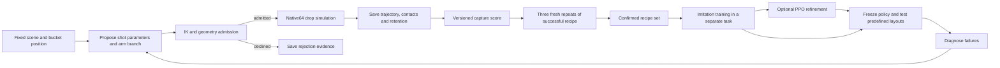

# Six remaining fixed-grid positions

This follow-up preserves the 29 confirmed recipes from the completed recovery
study and investigates the six original grid positions that remain unresolved.
It does not retrain or activate a policy. The original policy score remains
24/35. This is recipe development on known positions, not held-out evaluation.

Four positions receive bounded alternative-pose experiments: grid 01-05,
03-04, 03-05 and 04-06. The two blocked positions, 03-00 and 03-06, receive a
CPU geometry audit of the actual compiled collision shapes. Bucket coordinates,
robot bases and existing clearance rules stay fixed. No blocked request is
silently converted into an admitted drop.

## What changes

For each searchable position, freeze 96 distinct numeric recipes and two
possible IK branch slots per recipe before observing any new flight outcome.
Recipes vary board X/Y/height, tilt and release gap, including coupled changes
around the bucket. Out-of-bounds proposals are discarded before freezing the plan; values are
never silently clipped. Bucket-facing dropper orientation stays fixed.

The new admission mode explores a larger bounded IK candidate pool and can
select a second distinct joint configuration for the same commanded endpoints.
Every selected branch must pass the existing full-pose endpoint and sampled
setup-path checks. If the requested branch does not exist, the request is
declined; it never falls back invisibly to the first branch. Branch pools and
selected joint vectors are saved with the exact command and source identities.

Search stops at a position once a discovered capture passes all three fresh
nominal repeats of the same action and joint branch. There are at most three
confirmation groups per position. All 29 known recipes are replayed unchanged,
with direct-capture, table-assisted-capture and expected-miss controls before
and after the experiment.

The maximum is 768 search requests, 36 confirmations, 29 preservation replays
and 18 controls: 851 requested slots. The worker is bounded to 7,200 seconds,
with a 5,400-second search cutoff and a separate CPU audit reserve. Actual
counts, missing branches, setup declines and budget truncation remain explicit.
Use only the 4090 under the shared cooperative lock, with an 8 GiB disk reserve.

## Unchanged scoring and evidence

Native64/v3 capture requires a board bounce, whole-ball entry and one continuous
second inside. Table and rim assistance count. Robot, floor and unattributed
contacts invalidate capture; invalid physics is separately reported and never
accepted as success. Three nominal repeats do not demonstrate robustness to
noise, placement variation or a different timestep.

The simulator uses known scene geometry for this stage. This is not camera or
point-cloud perception. Arms hold admitted articulated endpoints during the
ball flight; setup-path sampling is a geometric check, not dynamic execution
of a learned transit or grasp controller.

## Overall learning workflow

The current task covers proposal, simulation, confirmation and diagnosis only.
Training would map scene observations to high-level shot parameters; IK remains
the joint-pose solver. There is no new model fitting or automatic promotion.

## Publication and isolation

Save local evidence and push compact source/results to the task branch. Do not
publish a new UI panel unless the user subsequently requests it. Keep the
existing UI, 4070 workload, Isaac installation, historical results, checkpoints,
raw observations and host configuration unchanged. No service restart or
physical hardware command is part of this task.
