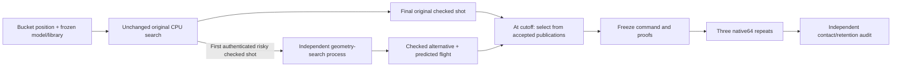

# Concurrent board-pose search: six-target development test

This is a **development experiment**, not training or a fresh-position score. It asks whether a second CPU search can find a better checked shot while the current planner continues working. The live planner and historical successful recipes are unchanged.

**Completed November 23:** none of the five missed targets recovered (0/3 each with both planners); the successful control stayed 3/3 with both. The alternate search admitted 23 of 69 checked configurations, but every admitted alternative predicted arm obstruction and no shot was replaced. Mean request time increased 28.192 → 31.522 seconds. All 54 native releases completed; the independent audit passed 45,635 checks. [Per-target results, diagnosis and provenance](../../baselines/mjlab-parallel-board-20261123/README.md). Keep the existing live planner.

The accepted immutable study is `parallel-board-v2`, producer `de3ecec18cb7d7c491ef152a43c4cafcffc8871e`. Its 55 focused tests and CI passed. V1 stopped before any native release when its verifier passed a two-method declaration to a baseline-only lifecycle check. V2 corrects that subset adapter, independently checks both fresh parallel processes, and uses newly prepared decisions. V1 source and evidence remain preserved; no physics or scoring change was involved.

## Why this test

The previous guarded comparison captured 15/20 with both methods. The guarded method waited for its original search to finish before trying another board position. At all five guarded-method misses, that original search used the full 30 seconds, so the extension never started. This statement concerns the original lane **inside the guarded method**; independently run baseline timings were not identical.

The sole previous fallback activation occurred at an already successful target. It preserved that shot because no replacement passed both clearance and aiming requirements. We retain those results; this test changes search scheduling, not physics, rewards or scoring.

## Frozen test definition

| Item | Definition |
|---|---|
| Targets | Five previous paired misses: source IDs 03, 09, 13, 15, 19; plus the successful regression control near (948.252, −97.816) mm |
| Source | Audited `guarded-board-fallback-v1` |
| Methods | Current `StalledReferencePlanner`; `ParallelBoardPlanner` |
| Decisions | One independently planned command per method/target: 12 total, frozen before native execution |
| Repeats | Three unchanged releases per checked command; a setup decline remains three requested attempts, zero releases |
| Physics | Existing calibrated native MuJoCo/mjlab scene, 64 substeps |
| Controls | Nine before and nine after: three direct, three table-assisted, three negatives each |
| Native cap | 36 development releases + 18 controls = at most 54; one 1800-second 4090 lease |
| Preserved | Models, shot libraries, scene/assets, original recipes, 4070 workload, Isaac setup and live service |

All six positions were deliberately selected from known results. Captures here cannot establish generalization. Report each target's captures **out of three**, and separately count targets that captured **3/3**. Do not call a target recovered if the independently replanned baseline also succeeds there.

## Concurrent planning



The alternate starts at the **first accepted original snapshot** containing a checked shot with predicted arm clearance below 5 mm or unavailable. Its source, clock, files and hashes are saved before alternative work begins. It uses its own spawned CPU process, resolver, engine and evidence directory. The original search continues; there is no 12-second interruption.

Both processes use the **same absolute 30-second decision window**. Only snapshots fully received and hash-validated before cutoff can enter selection. After stopping workers, deterministic final comparison and receipt assembly may finish after cutoff; that overhead is included in full request time, and no late candidate is admitted. Original initialization happens before that clock. Alternate startup consumes the remaining time. This is equal decision time, **not equal CPU cost**: parallel planning uses another CPU process and fresh original initialization for each request, while the baseline can reuse a clean worker. Full request time, decision time and sampled process CPU time are recorded separately. CPU samples at a deadline are labelled incomplete lower bounds.

The deterministic alternate menu varies board XY, height and heading using the existing bounded relative grid and Halton proposals. Necessary reach screening and nominal flight predictions produce a bounded shortlist, followed by full IK/path checks and full-pose flight prediction. At final selection, a new alternative must have finite predicted route arm clearance **at least 5 mm** and a finite score **strictly greater than the final original shot's score**. It is compared with the latest original result, not its older trigger shot. Ties, invalid scores or worker errors retain the original. No native outcome labels enter either planner.

Original and alternate path certificates remain in separate directories. Native replay uses the admitting directory; it never rewrites a proof to make an alternative appear admitted by the original.

## Reproduce

Use the pinned Ubuntu environment and a frozen source snapshot. Inputs are the existing audited native parent, audited guarded comparison, corrected reference scene and asset directory. Arguments are stored outside evidence as `.study-args.json` by the runtime owner.

```bash
# Supply the same frozen arguments to every stage:
CUDA_VISIBLE_DEVICES='' python -m sircus.mjlab.parallel_board_study --stage initialize ...
CUDA_VISIBLE_DEVICES='' python -m sircus.mjlab.parallel_board_study --stage prepare ...
CUDA_VISIBLE_DEVICES='' python -m sircus.mjlab.parallel_board_study --stage preflight \
  --audit-output /separate/path/parallel-board-v1-preflight.json ...
# Only after preflight passes and the shared lease becomes available:
CUDA_VISIBLE_DEVICES=GPU-ab1950b0-01dd-0fab-407f-2d17936b27f4 \
  python -m sircus.mjlab.parallel_board_study --stage run ...
CUDA_VISIBLE_DEVICES='' python -m sircus.mjlab.parallel_board_study --stage finalize ...
CUDA_VISIBLE_DEVICES='' python -m sircus.mjlab.parallel_board_study --stage audit \
  --audit-output /separate/path/parallel-board-v1-audit.json ...
```

Required arguments: `--parent-study`, `--parent-audit`, `--source-study`, `--source-audit`, `--reference`, `--assets`, `--output`, `--gpu-lock`. `--gpu-wait-s` limits waiting without interrupting another workload. Audit outputs must be new files outside raw evidence. After finalization, raw evidence is immutable. Publish only a derived display using `parallel_board_publish`; its destination checks protect the new study, both source studies and all audit receipts, including symlink targets.

Preparation-only audit independently verifies source bindings, all original and alternate snapshot choices, shared-clock receipt timing, deterministic menus, full pose/path proofs, exact context copies, final selection, and three unchanged repeats. It explicitly defers native-start binding and all native outcomes. The final audit additionally reconstructs contacts, routes and one-second whole-ball retention from saved native arrays, verifies both control blocks, and binds the report and complete evidence manifest. A preparation receipt is never a final result.

## What this can establish

A useful result is a new **3/3** capture at a previously missed target without losing the successful control, with acceptable planning and CPU cost. If it helps, freeze the method before a separate fresh-position comparison. If it does not, inspect whether the alternative obtained useful CPU time, produced feasible poses, or merely predicted a flight that native physics did not reproduce. No default promotion or more training is part of this development test.
